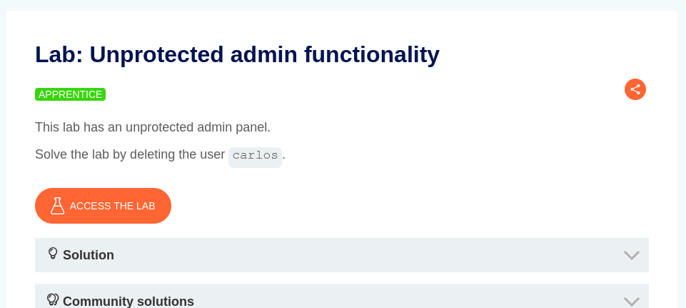
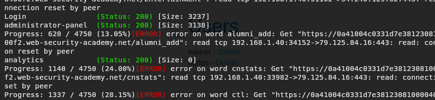
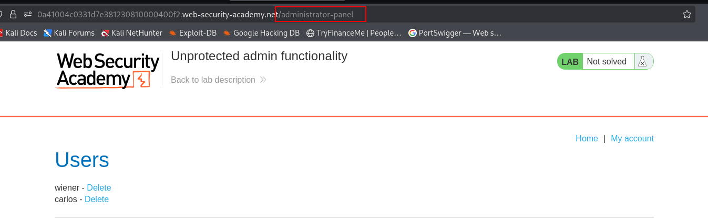
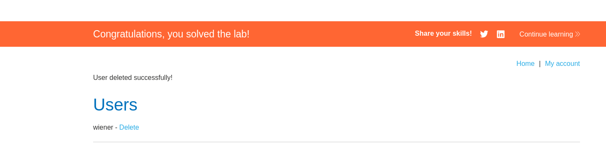

# Lab 01 — Unprotected Admin Functionality

**Category:** Broken Access Control  
**Lab level:** Apprentice  
**Status:** Completed

## Overview

This lab demonstrates an access-control vulnerability in which the administrative interface is accessible without the required authorization checks.

The application exposes an administrative panel at `/administrator-panel`. The path can be discovered through the site's `robots.txt` file or by performing directory enumeration.

## Testing and exploitation

### 1. Inspect the application

I examined the application and identified the administrative functionality that should have been restricted to authorized administrators.



### 2. Discover the administrative path

The administrative path was discoverable through `robots.txt`. Directory enumeration can also help identify exposed paths.

```bash
gobuster dir -u https://TARGET/ -w /path/to/wordlist.txt
```



### 3. Access the administrative panel

I browsed to `/administrator-panel` and confirmed that the application allowed access without verifying that the current user had administrative privileges.



### 4. Complete the lab

Using the exposed administrative functionality, I deleted the user `carlos`.



## Root cause

The application relied on an obscured or discoverable URL instead of enforcing authorization on the server side. Knowing or guessing an administrative URL must never be sufficient to access privileged functionality.

## Security recommendations

- Enforce authorization checks on every administrative endpoint.
- Verify the user's role and permissions on the server for each request.
- Do not treat `robots.txt`, hidden links, or obscure URL paths as security controls.
- Apply deny-by-default access-control rules.

## Key takeaway

An administrative URL is not protected simply because it is hidden. Access control must be enforced by the server for every request.
