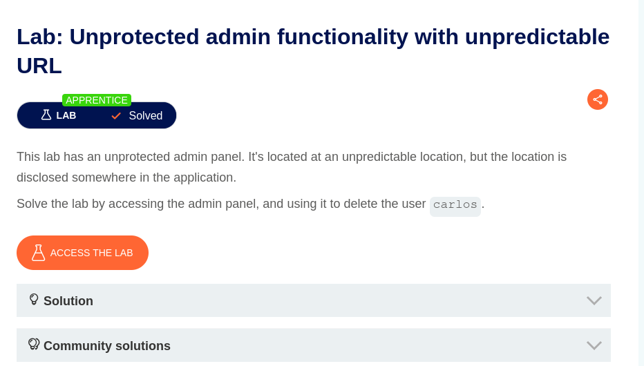
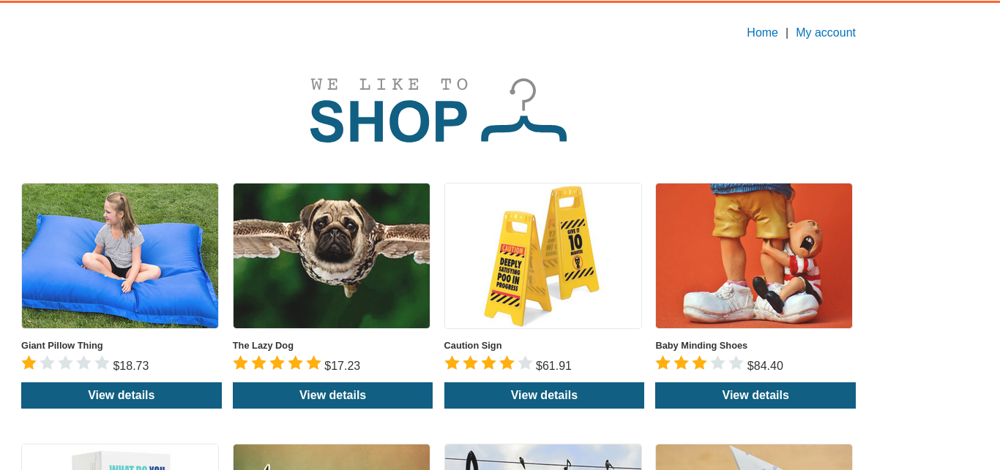
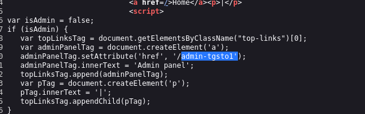
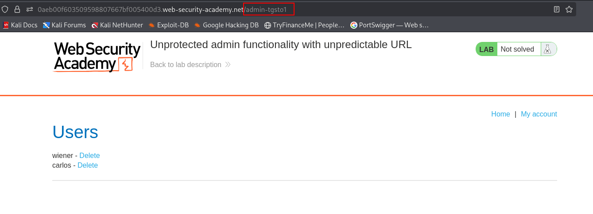
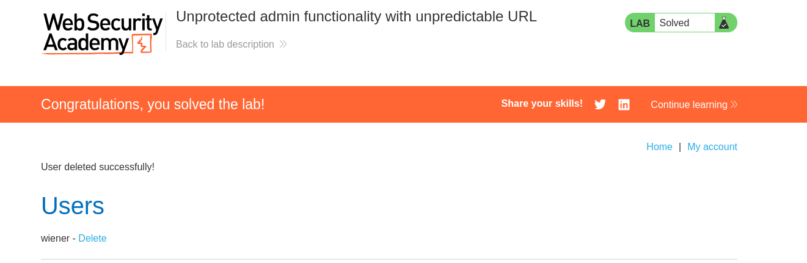

# Lab 02 — Unprotected Admin Functionality with an Unpredictable URL

**Category:** Broken Access Control  
**Lab level:** Apprentice  
**Status:** Completed

## Overview

This lab demonstrates why an unpredictable or obscure administrative URL is not a substitute for proper access control.

The application references the administrative path in client-side JavaScript. By inspecting the page source, the path can be recovered and accessed directly.

## Testing and exploitation

### 1. Inspect the lab

I opened the application and reviewed the available page content.

### 2. Examine the page source

I inspected the page source and located the administrative path referenced by the client-side JavaScript.

Because the path was exposed to the client, it could be recovered without needing to guess it.

### 3. Access the administrative functionality

I used the discovered path to access the administrative interface and performed the required action.

### 4. Complete the lab

The lab was completed after deleting the user `carlos`.

## Root cause

The application attempted to protect administrative functionality through an obscure URL, but it did not enforce authorization when the endpoint was requested.

Client-side code and page source are visible to users and must not contain secrets or be relied upon to protect privileged functionality.

## Security recommendations

- Enforce server-side authorization on administrative routes.
- Treat all client-side code and page source as publicly accessible.
- Do not rely on URL secrecy or obscurity as an access-control mechanism.
- Apply role-based authorization checks to sensitive operations.

## Key takeaway

An unpredictable URL may make an endpoint harder to discover, but it does not make the endpoint secure.
