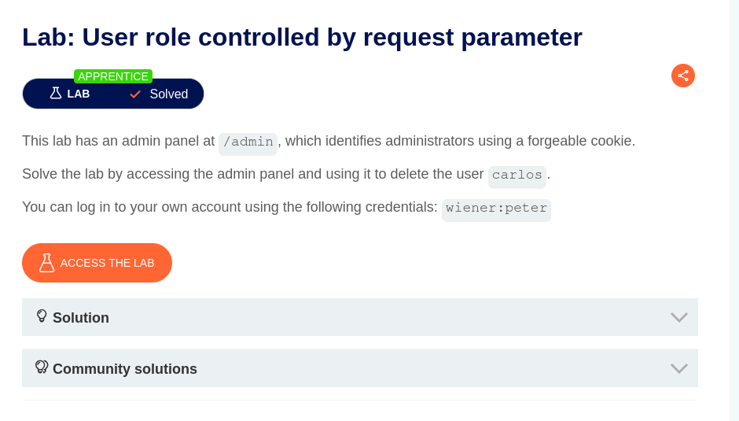
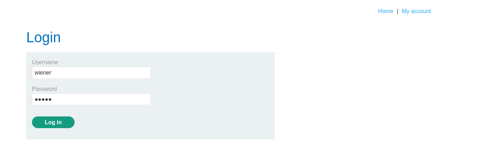
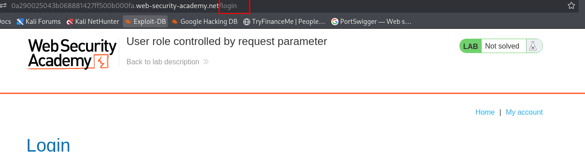
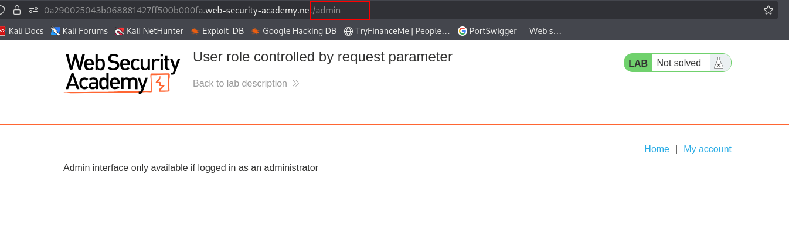
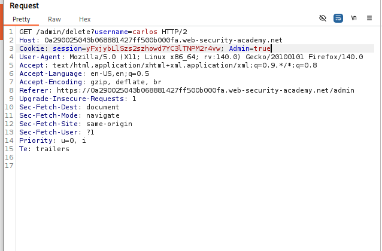
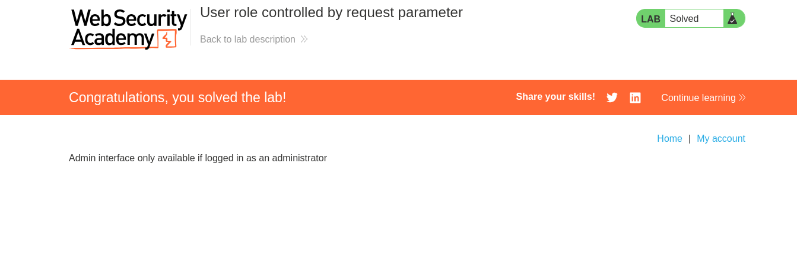

# Lab 03 — User Role Controlled by Request Parameter

**Category:** Broken Access Control  
**Lab level:** Apprentice  
**Status:** Completed

## Overview

This lab demonstrates privilege escalation caused by trusting a client-controlled request parameter to determine a user's role.

A normal user can modify request data and attempt to access functionality intended only for administrators.

## Testing and exploitation

### 1. Review the application

I opened the lab and examined the available account and login functionality.

### 2. Inspect the normal user account

I used the credentials supplied by the lab to access the normal user account.

### 3. Examine the relevant endpoint and request

I inspected the application's requests and identified the endpoint and role-related value involved in the access-control decision.

### 4. Modify the request

I modified the relevant request data, changing the role-related value from `Admin=false` to `Admin=true`, and sent the modified request.

The application accepted the modified role value and granted administrative access.

### 5. Complete the lab

After reaching the administrative functionality, I deleted the user `carlos`.

## Root cause

The server trusted a role value supplied or controlled by the client. Authorization decisions must be based on trusted server-side data, not on parameters that a user can modify.

## Security recommendations

- Store and manage user roles on the server side.
- Never accept a client-supplied role value as proof of authorization.
- Check permissions for every privileged request.
- Reject unauthorized attempts to modify role or privilege attributes.

## Key takeaway

Client-controlled request parameters must never determine whether a user is an administrator.
