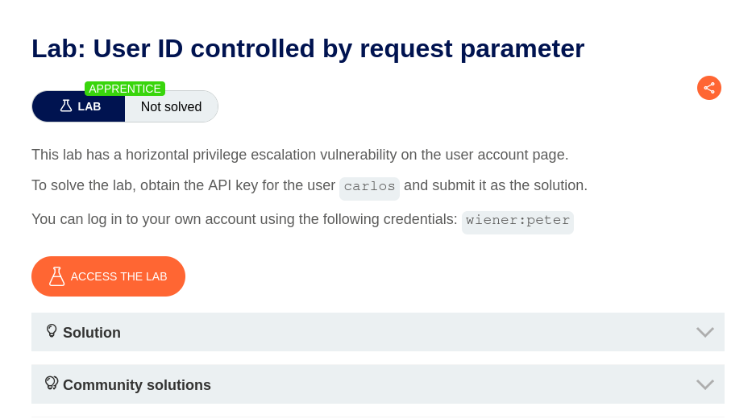
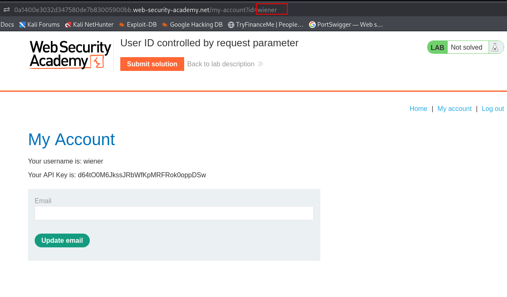
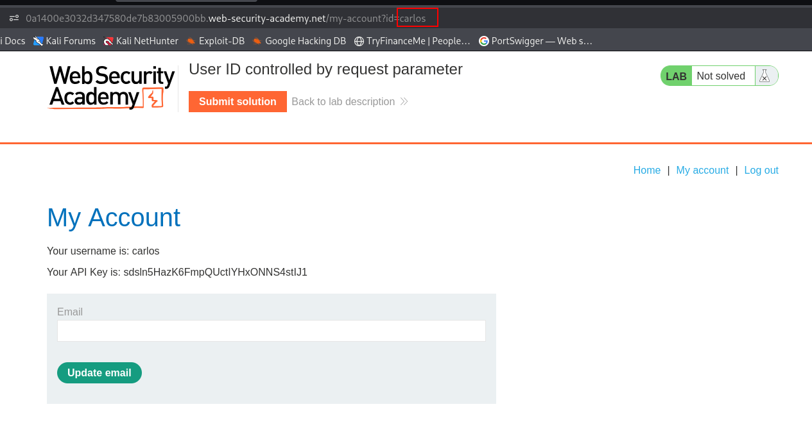
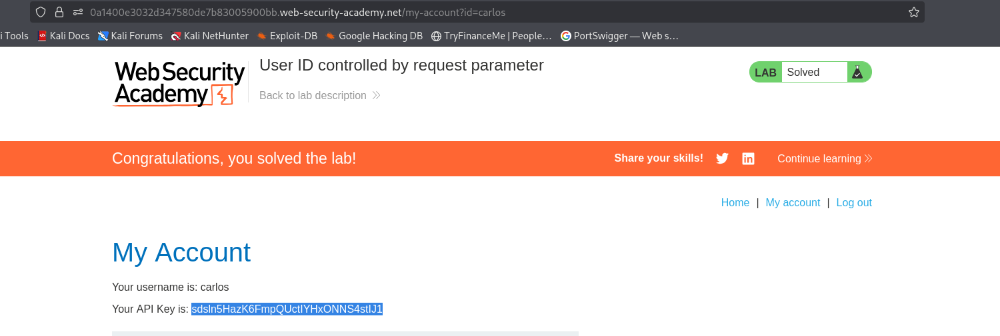

# Lab 07 — User ID Controlled by Request Parameter

**Category:** Broken Access Control — IDOR  
**Lab level:** Apprentice  
**Status:** Completed

## Overview

This lab demonstrates horizontal privilege escalation caused by an insecure direct object reference (IDOR).

The application uses a user identifier in a request parameter to retrieve account information. By changing the identifier, a logged-in user can access another user's information.

## Testing and exploitation

### 1. Inspect the lab

I opened the lab and reviewed the account functionality.



### 2. Log in as the normal user

I logged in using the credentials supplied by the lab and examined the account page.



### 3. Modify the user ID

I identified the `id` parameter in the URL. It contained the current user's identifier:

```text
?id=wiener
```

I changed the value to:

```text
?id=carlos
```



The application returned Carlos's account information, including the API key.

### 4. Complete the lab

I submitted the retrieved API key as required by the lab.



## Root cause

The server used a user-controlled identifier to retrieve account information without checking whether the authenticated user was authorized to access the requested account.

## Security recommendations

- Verify object-level authorization on every request.
- Ensure users can access only records they are permitted to view.
- Do not rely on the identifier being difficult to guess.
- Consider indirect identifiers as an additional defence, not as a replacement for authorization checks.

## Key takeaway

Changing an object identifier should never allow one user to access another user's private information.
