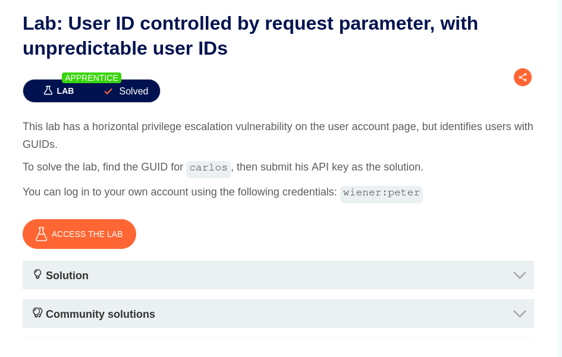
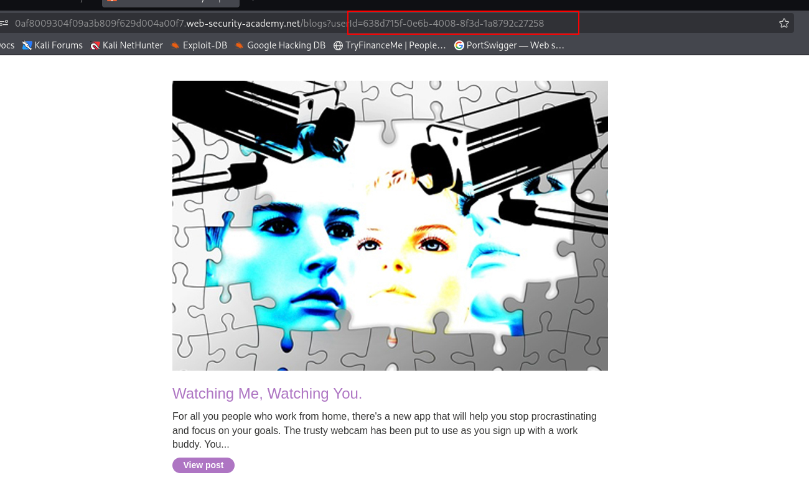
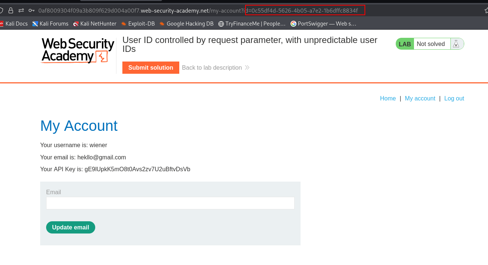
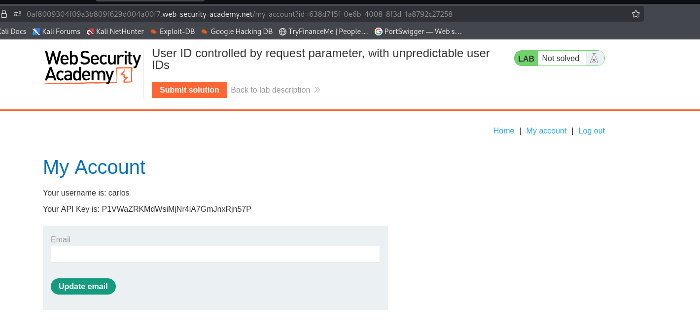
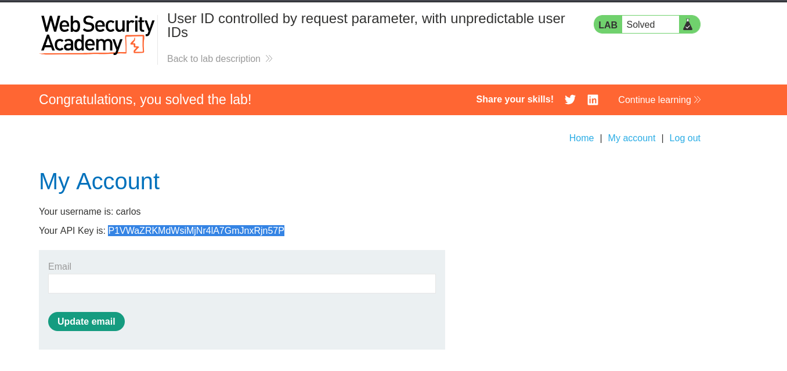

# Lab 08 — User ID Controlled by Request Parameter, with Unpredictable User IDs

**Category:** Broken Access Control — IDOR  
**Lab level:** Apprentice  
**Status:** Completed

## Overview

This lab demonstrates that unpredictable identifiers do not prevent IDOR vulnerabilities when the application fails to enforce object-level authorization.

The application exposes user identifiers in blog-related content. These identifiers can be collected and then used in a request parameter to access another user's account information.

## Testing and exploitation

### 1. Inspect the lab

I opened the application and reviewed the available blog content.

### 2. Identify exposed user identifiers

I examined the blog authors and found that user identifiers were exposed in the application.

The administrator's identifier could also be discovered through the available content.

### 3. Compare account identifiers

I logged in as `wiener` and examined the identifier used to retrieve the account information.

I then replaced Wiener's identifier with Carlos's identifier.

The application returned Carlos's account information, including the API key.

### 4. Complete the lab

I used the retrieved information to complete the lab.

## Root cause

The application relied on the identifier being difficult to predict rather than checking whether the current user was authorized to access the requested account.

Even globally unique or random identifiers do not provide authorization.

## Security recommendations

- Enforce object-level authorization for every account and data request.
- Treat all identifiers as untrusted input.
- Do not rely on UUIDs or other unpredictable identifiers as an access-control mechanism.
- Avoid unnecessarily exposing internal identifiers in public content.

## Key takeaway

Unpredictable IDs can make enumeration harder, but they do not fix an IDOR vulnerability.
