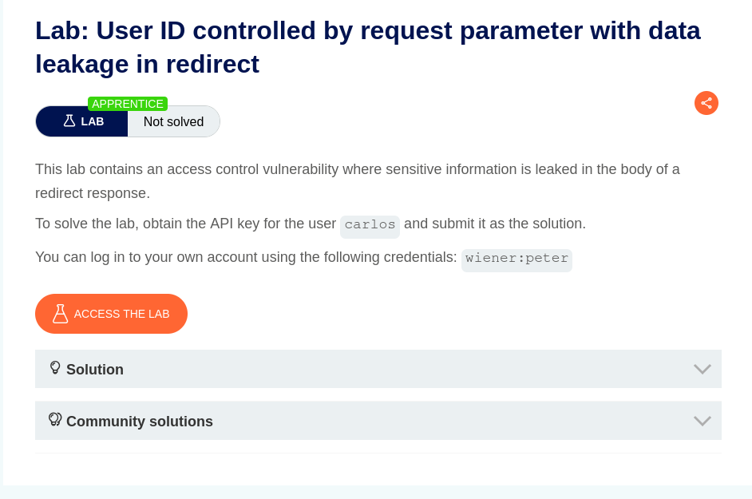
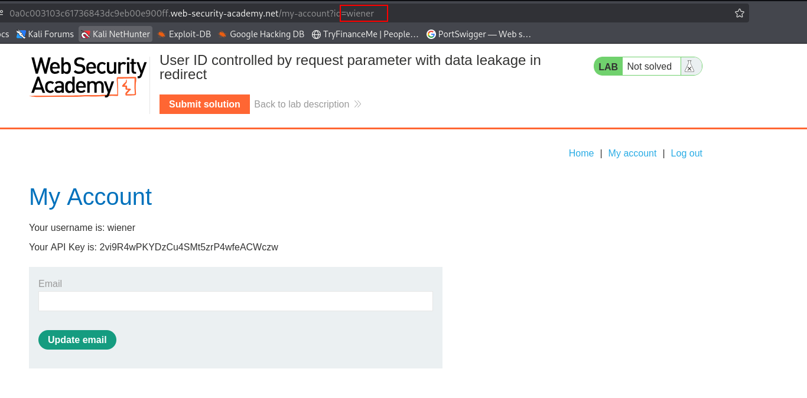
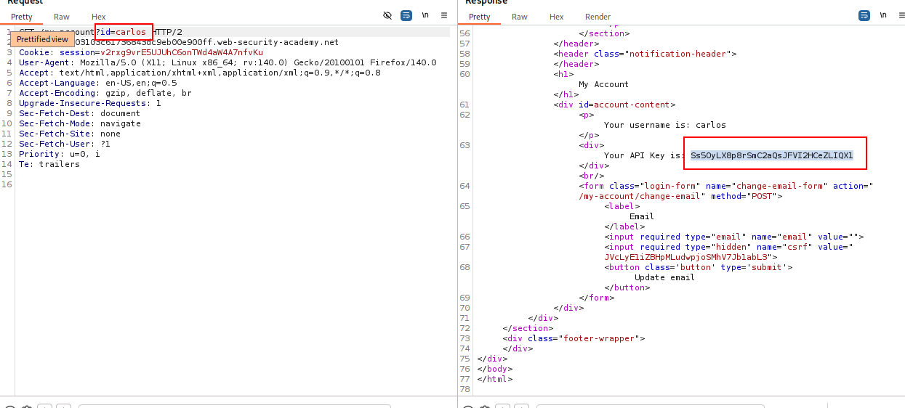
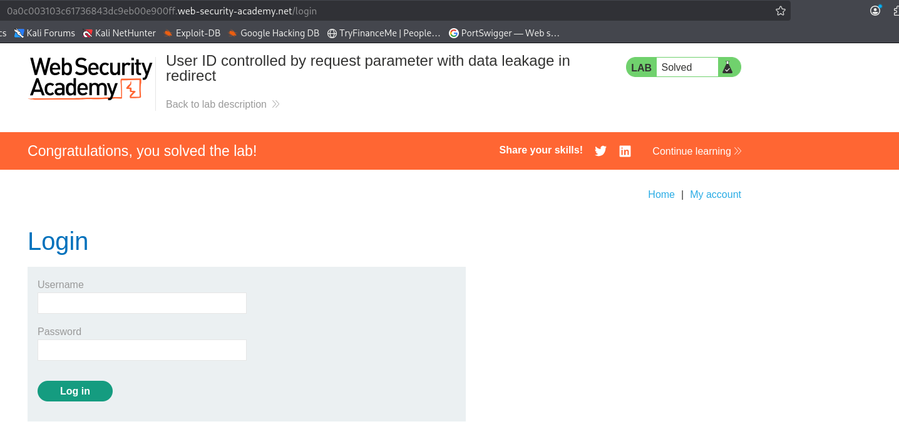

# Lab 09 — User ID Controlled by Request Parameter with Data Leakage in Redirect

**Category:** Broken Access Control — IDOR / Information Disclosure  
**Lab level:** Apprentice  
**Status:** Completed

## Overview

This lab demonstrates how changing a user identifier can expose another user's sensitive information, even when the application redirects the requester to a login page.

A redirect does not necessarily mean that the original request was handled securely. Sensitive information may still be included in the response.

## Testing and exploitation

### 1. Inspect the lab

I opened the lab and reviewed the account functionality.

### 2. Examine the normal user's identifier

I logged in as `wiener` and examined the user identifier used in the relevant request.

### 3. Modify the user ID

I changed the identifier from `wiener` to `carlos` and sent the modified request.

Although the application redirected the browser to the login page, I inspected the response itself rather than relying only on the browser's final page.

The response disclosed Carlos's API key despite the redirect.

### 4. Complete the lab

I used the exposed API key to complete the lab.

## Root cause

The application did not properly authorize access to the requested user's data. Sensitive information was included in the response even though the application subsequently issued a redirect.

## Security recommendations

- Perform authorization checks before retrieving or returning sensitive data.
- Ensure unauthorized responses do not contain confidential information.
- Review the complete HTTP response, including redirect responses.
- Return an appropriate denial response without exposing protected data.

## Key takeaway

A redirect does not guarantee that sensitive information has been protected. Always inspect the complete HTTP response during security testing.
