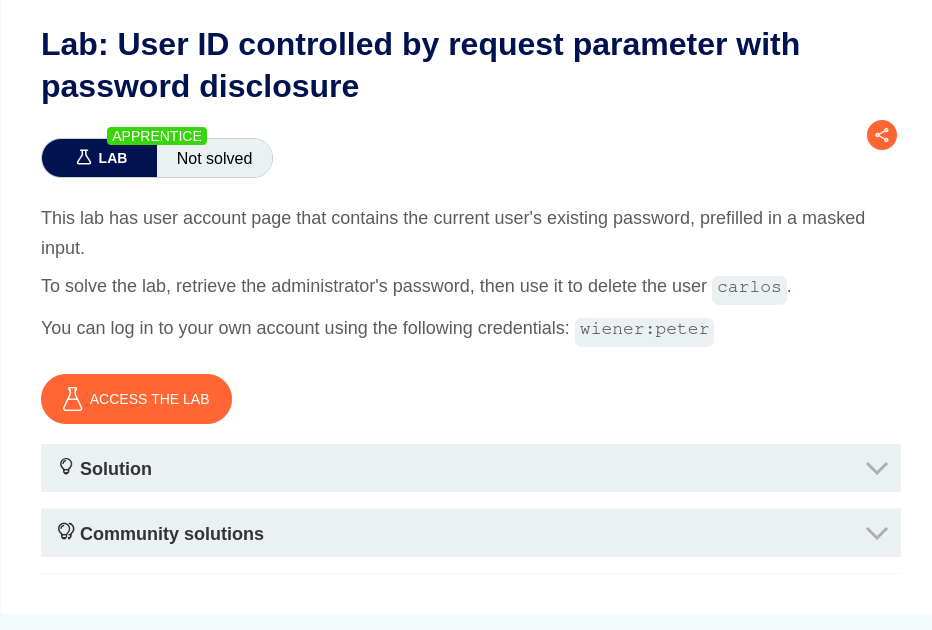
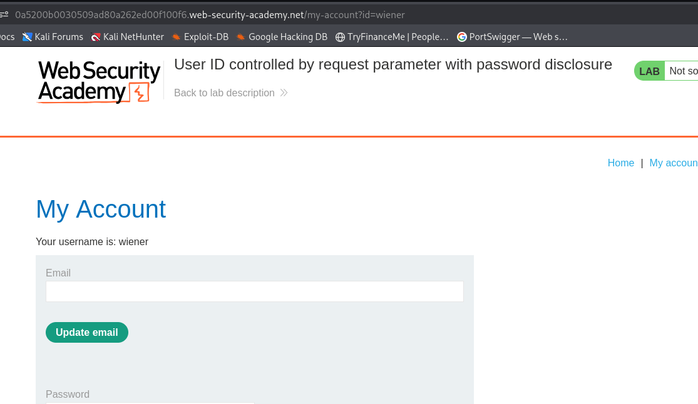
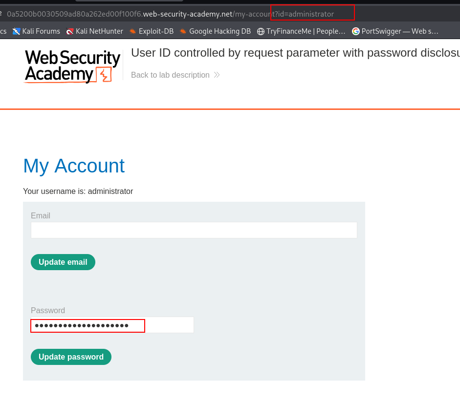
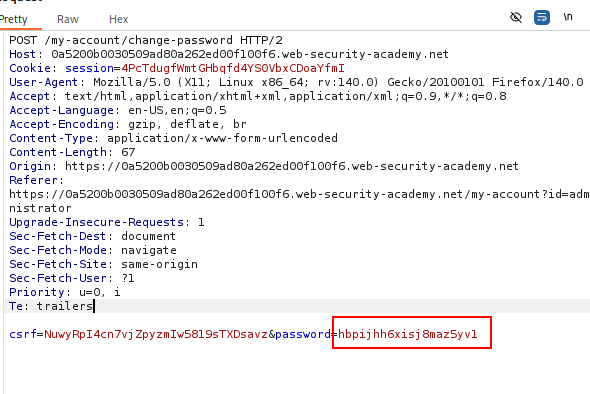
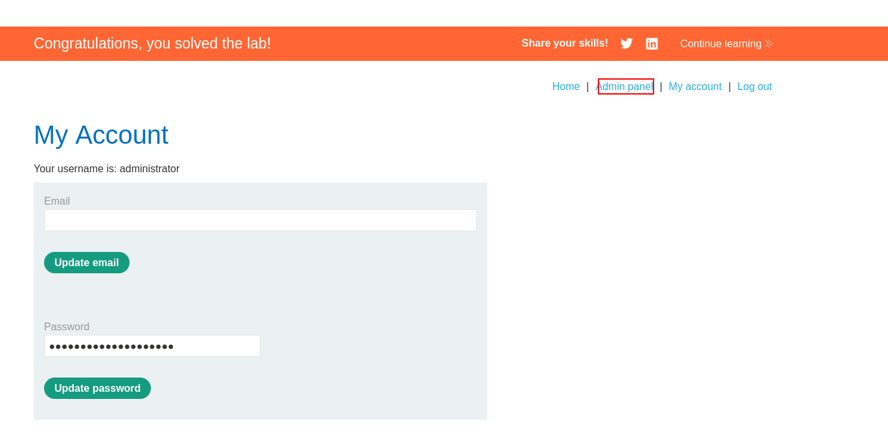
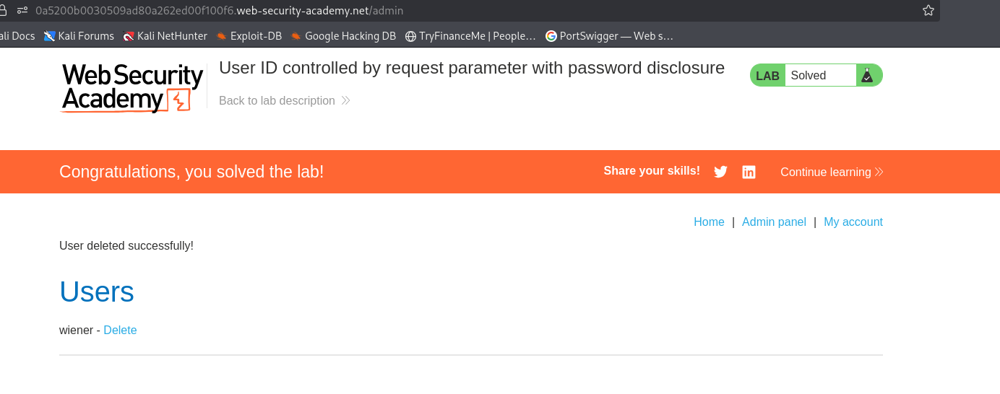

# Lab 10 — User ID Controlled by Request Parameter with Password Disclosure

**Category:** Broken Access Control — IDOR / Sensitive Information Disclosure  
**Lab level:** Practitioner  
**Status:** Completed

## Overview

This lab demonstrates how manipulating a user identifier can expose sensitive account information belonging to another user.

The application displays a masked password in the account interface. By changing the user identifier and inspecting the relevant update request, the underlying password value can be disclosed.

## Testing and exploitation

### 1. Inspect the lab

I opened the lab and reviewed the account functionality.

### 2. Examine the normal user's account

I logged in as `wiener` and examined the user identifier used by the application.

### 3. Change the user identifier

I modified the identifier to target the administrator's account.

### 4. Inspect the password update request

I initiated the password update functionality and captured the corresponding request.

Although the password appeared masked in the browser interface, inspection of the request revealed that sensitive password information was exposed.

### 5. Access the administrative panel

Using the disclosed credentials, I accessed the administrative panel.

### 6. Complete the lab

I used the administrative functionality to delete the user `carlos`.

## Root cause

The application allowed access to another user's account data through a user-controlled identifier and exposed sensitive password information in the account update flow.

Masking a value in the user interface does not protect it if the underlying response or request still contains the original value.

## Security recommendations

- Enforce object-level authorization before returning or updating account information.
- Never expose passwords in profile pages, API responses, or update requests.
- Store passwords using a strong, salted password-hashing algorithm.
- Do not retrieve or display users' original passwords; use a secure password-reset workflow.
- Avoid allowing users to update another account's credentials without appropriate authorization.

## Key takeaway

Sensitive information must be protected at the server and API level. Hiding a password visually does not make it secure.
