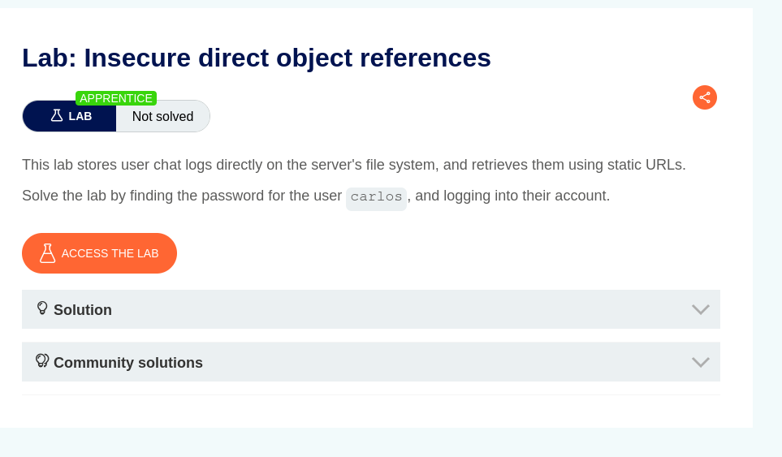
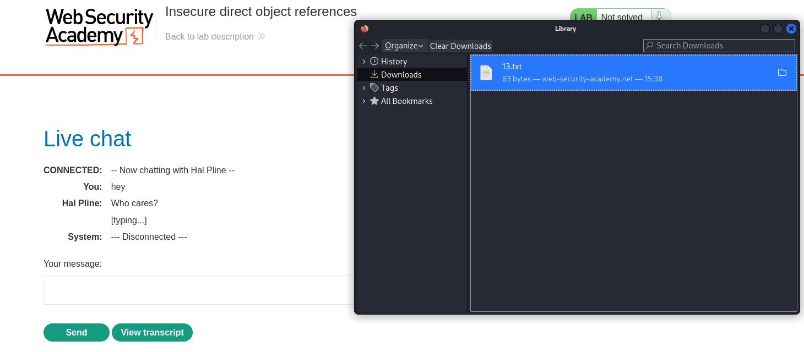
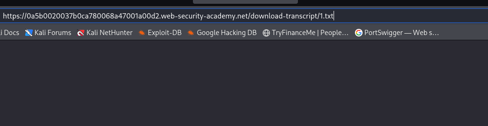
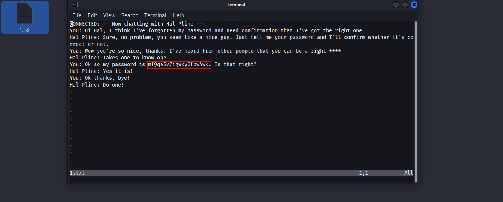
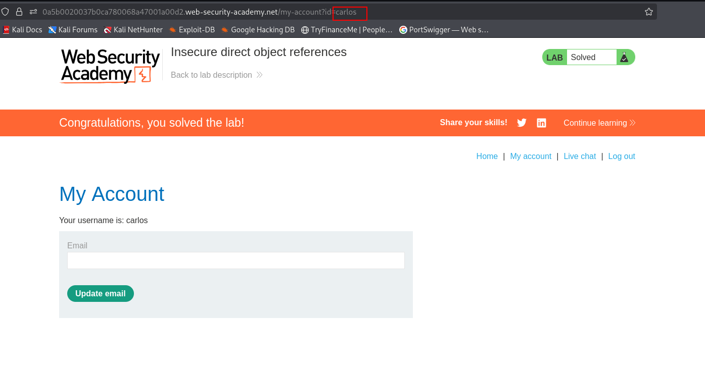

# Insecure Direct Object References (IDOR)

## Overview

This lab demonstrates an Insecure Direct Object Reference (IDOR) vulnerability through a live-chat transcript download feature.

## Objective

Identify the predictable file naming pattern used for downloaded live-chat transcripts, access another transcript by changing the file reference, and use the credentials found in that transcript to log in as the target user.

## Vulnerability

**Insecure Direct Object Reference (IDOR)**

The application provides access to live-chat transcript files through predictable filenames. By changing the referenced filename, a user can access a transcript that belongs to another user without the application properly checking authorization.

## Procedure

### 1. Start a live-chat conversation

Open the live-chat feature, send a message, and wait for the response.

### 2. Download the chat transcript

After receiving the response, select **View transcript** and wait for the transcript file to download.

Observe the downloaded filename. The lab uses a predictable numeric naming pattern, such as `1.txt`, `2.txt`, and so on.

### 3. Inspect and modify the download URL

Right-click the downloaded transcript and copy its download link. Open the link in Burp Suite's browser or intercept the relevant request.

Modify the transcript filename in the URL to `1.txt`, as instructed by the lab, and send the request.

### 4. Inspect the downloaded transcript

Open the downloaded `1.txt` file and inspect its contents. The transcript contains credentials for the target user.

### 5. Log in as the target user

Return to the application and log in as `carlos`, using the password found in `1.txt`.

## Key Takeaways

- IDOR vulnerabilities occur when an application exposes direct references to objects without correctly checking whether the current user is authorized to access them.
- Predictable filenames or identifiers can make it easier to discover other users' resources.
- Test whether changing an object reference exposes data belonging to another user.
- Applications should perform server-side authorization checks for every requested object; unpredictable identifiers alone are not an authorization control.

## Result

The lab was completed successfully. By changing the transcript filename to `1.txt`, the other user's chat transcript was accessed and the credentials found in it were used to log in as `carlos`.
